Forests are three-dimensional, but a view from above shows little of what lies below the canopy.
LiDAR (Light Detection and Ranging) scans a forest with laser pulses and records where they hit
vegetation and ground. The result is a *point cloud*: millions of points, each with a position and
an elevation. To study single trees, for example their height or crown size, we first have to find
out which points belong to which tree. This step is called *individual-tree segmentation*.

In this tutorial, you will use the 3Dtrees tools () in Galaxy to prepare
one drone LiDAR point cloud, predict individual trees with SegmentAnyTree (SAT)
(), and inspect the result in an interactive 3D viewer. The workflow was
built by the 3Dtrees community, and the data are part of the THEIA data hub.

> <tip-title>New to Galaxy?</tip-title>
>
> If Galaxy is new to you, first try [Galaxy Basics for everyone]().
>
{: .tip}

> <comment-title>Which Galaxy server?</comment-title>
>
> This tutorial was prepared on [Galaxy Europe](https://usegalaxy.eu), where all 3Dtrees tools are
> installed. The screenshots come from its [Earth System](https://earth-system.usegalaxy.eu) view.
>
{: .comment}

> <agenda-title></agenda-title>
>
> In this tutorial, we will cover:
>
> 1. TOC
> {:toc}
>
{: .agenda}

# Get the data

The data were collected by drone over a Mediterranean oak forest near Pic Saint-Loup in southern
France (). The dataset has four files, one per flight area. We use only the
smallest, `Strip-20210804-150144_D.las` (477 MB). LAS is a common file format for LiDAR points;
LAZ is its compressed version.

> <details-title>About the Pic Saint-Loup dataset</details-title>
>
> The flights took place in June 2021 with a YellowScan Surveyor scanner on a DJI Matrice 600 Pro
> drone, as part of the SENTHYMED/MEDOAK experiment (). The dates in the file
> names record when post-processing finished. The data have about 200--250 points per square metre,
> use the RGF93 / Lambert-93 coordinate reference system, and are published under the Etalab Open
> License 2.0.
>
> The four files are separate flight areas, not tiles of one survey: A and B do not touch, while C
> and D overlap. Processing them together would need extra alignment and overlap checks, which is
> why this tutorial uses only file D.
>
{: .details}

> <details-title>What is THEIA?</details-title>
>
> The dataset is part of THEIA, the data and services hub for continental surfaces of the
> [Data Terra research infrastructure](https://www.data-terra.org/). The
> [THEIA catalogue](https://catalogue.theia.data-terra.org/) collects metadata from thematic and
> institutional repositories, including the INRAE repository that hosts this dataset.
>
> {: style="width: 200px; max-width: 100%;"}
>
{: .details}



<div class="Get-data" markdown="1">

> <hands-on-title>Import file D</hands-on-title>
>
> 1. Create a new history for this tutorial.
>
>    
>
> 2. Import the file from this address, with **Type** set to `laz`:
>
>    ```
>    https://entrepot.recherche.data.gouv.fr/api/access/datafile/121030
>    ```
>
>    
>
>    > <comment-title>Why laz for a LAS file?</comment-title>
>    >
>    > The Standardization tool currently only lists `laz` datasets. It reads the LAS content
>    > correctly and writes a real LAZ file for all later steps.
>    {: .comment}
>
>    > <tip-title>Browsing the repository instead</tip-title>
>    >
>    > You can also select **Choose from repository** in **Upload**, open **Recherche Data Gouv**,
>    > search for `pic` and open **Données lidar acquises par drone au pied du Pic St Loup (34)**.
>    > Note that there is 4 datafiles on the repository, only one file is needed for the tuto.
>    > In our test, this import stopped at 187 MB without an error, so check the file size
>    > afterwards.
>    >
>    > 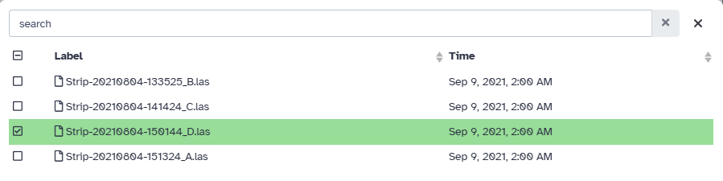
>    {: .tip}
>
> 3. When the dataset turns green, expand it and check that it is **476.9 MB**. A smaller file
>    means the download stopped early: delete it and import it again.
>
>    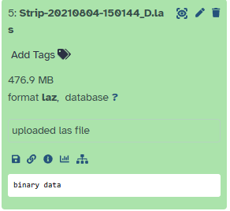{: style="width: 220px; max-width: 100%;"}
>
> 4. Rename the dataset, which is named after the address, to `Strip-20210804-150144_D.las`.
>
>    
>
{: .hands_on}

</div>

<div class="History" markdown="1">

> <hands-on-title>Import the prepared history</hands-on-title>
>
> 1. Open the history [Pic Saint Loup](https://earth-system.usegalaxy.eu/u/marie.josse/h/pic-saint-loup)
>    and select **Import this history** at the top right. It contains file D.
> 2. Change the datatype of `Strip-20210804-150144_D.las` to `laz`, so the Standardization tool
>    can use it.
>
>    
>
{: .hands_on}

</div>

# Discover the 3Dtrees workflow

The following sections go through the 3Dtrees workflow step by step, from a raw point cloud to
individual trees.

> <details-title>What is 3Dtrees.earth?</details-title>
>
> [3Dtrees.earth](https://3dtrees.earth/) is a community building a global forest reference: researchers
> share high-quality 3D forest data to advance science, AI and sustainability. It is part of
> [NFDI4Earth](https://www.nfdi4earth.de/).
>
> {: style="width: 160px; max-width: 100%;"}
>
{: .details}

## Standardize the point cloud

Scanners and processing software store point clouds in slightly different ways. The Standardization
tool checks the file header, spatial bounds, point density and coordinate reference system, and
writes a clean LAZ file that the following tools can rely on. It does not detect trees.

> <hands-on-title>Standardize file D</hands-on-title>
>
> 1.  with the following parameters:
>    - *"Mode"*: `Single File Standardization`
>        -  *"Point Cloud File"*: `Strip-20210804-150144_D.las`
>
>    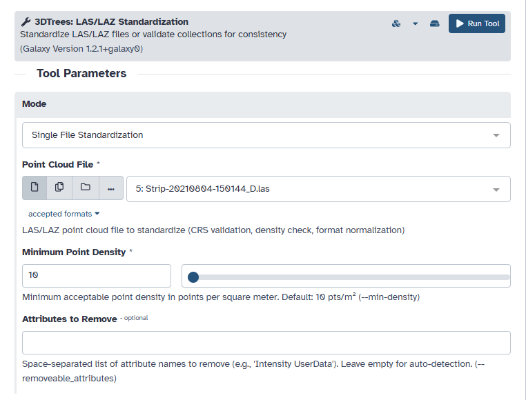
>
>    The tool returns `standardized` (the point cloud used from now on), `metadata` (a JSON
>    summary) and `convex_hull` (the survey footprint as GeoJSON).
>
{: .hands_on}



> <solution-title>Why standardize a point cloud?</solution-title>
>
> For file D, the tool checks for example that the bounding box and point count in the header match
> the points, that the coordinate reference system (RGF93 / Lambert-93) is valid and in metres, that
> the points lie on land, and that the file follows the LAS/LAZ format conventions. It stores the
> results in `metadata` (point count, bounding box, coordinate reference system and attributes,
> before and after standardization) and the survey outline in `convex_hull`. Tree identifiers are
> not part of this step; they come from the segmentation model.
>
{: .solution}

## Get a first impression with overview images

Before predicting trees, look at the data. The Overviews tool draws images that open directly in
Galaxy: top views show the extent of the survey and gaps in the canopy, section views show the
ground and the vegetation layers above it.

> <hands-on-title>Create and inspect overview images</hands-on-title>
>
> 1.  with the following parameters:
>    -  *"Point Cloud Collection"*: `standardized` (output of **3DTrees: LAS/LAZ Standardization** )
>
> 2. Open the images in the **Top View Images** and **Section View Images** collections (two each).
>
{: .hands_on}

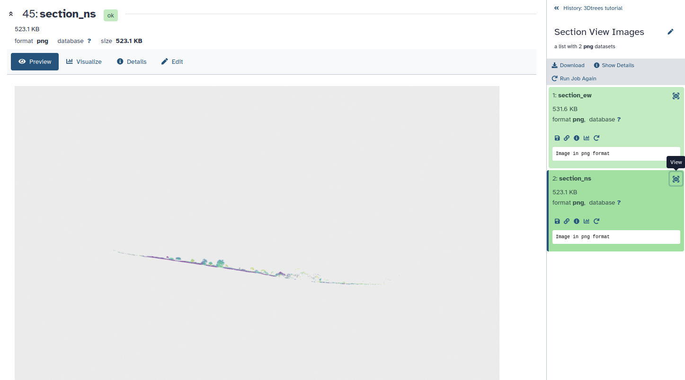

The forest is less than 15 m tall but the survey is about 270 m long, so in the preview the
section is a thin strip. Open the image at full size and zoom in. The images below show what you
can see: the whole north--south section at true scale, and two close-ups.

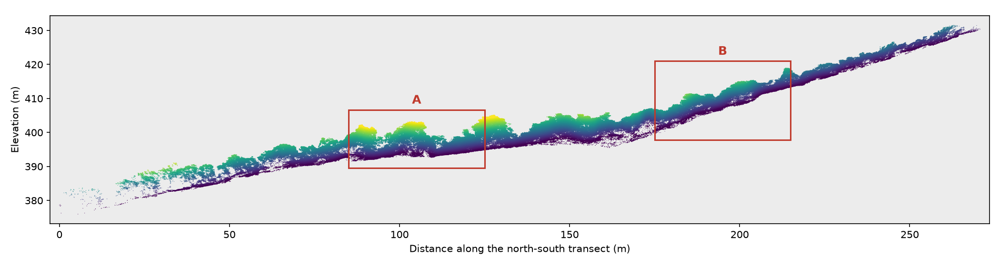

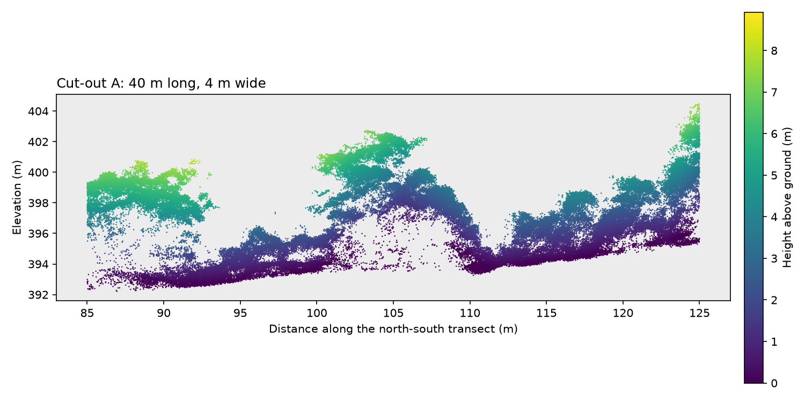

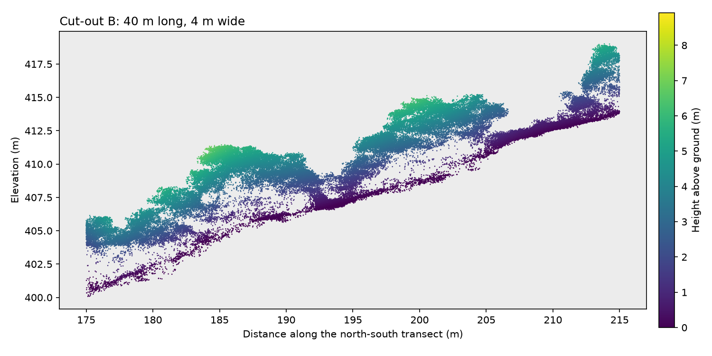

> <details-title>How these images were made</details-title>
>
> They were drawn outside Galaxy from file D. The full section is 10 m wide, like the default
> **Section Width** of the Overviews tool; the close-ups use a 4 m slice so that fewer crowns
> overlap. Colours show height above an estimated ground level.
>
{: .details}



> <solution-title>What can the overview tell you?</solution-title>
>
> Gaps are easiest to see from above, layers from the side. Where crowns touch, as in close-up B,
> there is no gap to mark where one tree ends, so separating trees is harder. Look at both areas
> again in the final viewer.
>
{: .solution}

## Prepare the data for segmentation

SmartTile prepares the point cloud for the model in two ways:

- **Tiling**: large surveys are cut into *tiles*, each with an overlapping *buffer* that gives the
  model context around trees at the edge. File D is below the default **Tiling threshold**
  (10000 MB), so it stays one tile.
- **Subsampling**: the points are reduced to one per 10 cm *voxel* (a small cube). SegmentAnyTree
  works at this resolution; the predictions are transferred back to every original point later.

> <hands-on-title>Tile and subsample</hands-on-title>
>
> 1.  with the following parameters:
>    - *"Task"*: `Tile and subsample`
>        -  *"Input LAZ/LAS files"*: `standardized` (output of **3DTrees: LAS/LAZ Standardization** )
>        - *"Tiling mode"*: `Buffered spatial tiles`
>        - In *"Output"*:
>            -  *"1: Output"*
>                - *"Resolution"*: `Subsampled`
>                    - *"Voxel size (cm)"*: `10`
>                - *"Format"*: `LAZ`
>
>    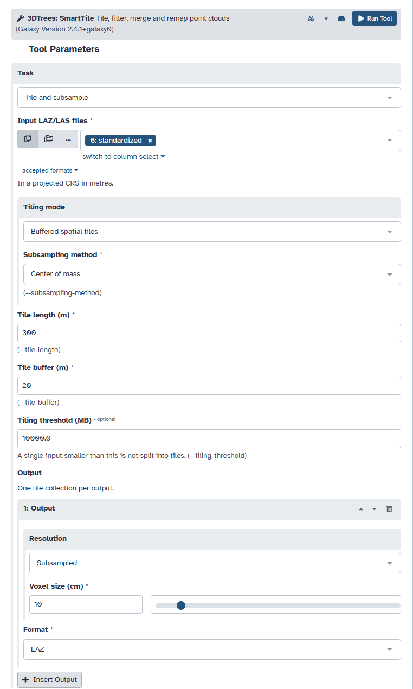
>
>    The outputs are `Tiles, output 1` (the subsampled tiles, input for SegmentAnyTree), a
>    `Tiling preview` map, and `Tile bounds JSON` (the tile layout, needed for the merge step).
>
{: .hands_on}



> <solution-title>Why use overlapping processing tiles?</solution-title>
>
> The buffer gives trees at the edge of a tile their surroundings, but it repeats points: a wider
> buffer costs more time and makes it more likely that a tree is predicted twice. The merge step
> later keeps each tree only once.
>
{: .solution}

## Identify individual trees with SegmentAnyTree

SegmentAnyTree is a deep-learning model trained on laser scans of many forest types
(). It adds two values to each point:

- `PredSemantic_SAT`, the *semantic* class: vegetation or non-vegetation (for example ground).
- `PredInstance_SAT`, the *instance*: an identifier shared by all points of one predicted tree.

Two neighbouring trees therefore have the same class but different instance identifiers.

> <hands-on-title>Predict trees</hands-on-title>
>
> 1.  with the following parameters:
>    -  *"Input Dataset"*: `Tiles, output 1` (output of **3DTrees: SmartTile** )
>    - *"Predicted instance dimension name"*: `PredInstance_SAT`
>    - *"Predicted semantic dimension name"*: `PredSemantic_SAT`
>
>    Select the input with the  **Dataset collection** button, so that
>    Galaxy runs the model on every tile. The dimension names are the defaults.
>
>    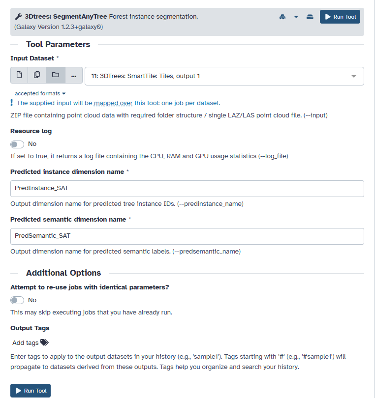
>
>    The job needs a GPU. In our run it waited about an hour in the queue and then ran for about 20
>    minutes. The output collection is called `Processed Files`.
>
{: .hands_on}



> <solution-title>Instance and semantic predictions</solution-title>
>
> In this tutorial, the semantic class separates vegetation from non-vegetation, and the instance
> identifies the individual tree. The instances are what make tree-based studies possible:
> predicting the species of each tree, measuring tree height or crown size, or counting trees.
>
{: .solution}

## Combine the predictions and transfer them to the original points

SmartTile now puts the tiles back together. Using the tile layout, it keeps each tree only in the
tile that owns it and joins trees cut by tile borders. With **Remap target** set to the original
file, it then copies the predictions from the 10 cm points to every point of the full-resolution
file, which keeps all its original attributes.

> <hands-on-title>Merge the predictions</hands-on-title>
>
> 1.  with the following parameters:
>    - *"Task"*: `Filter / merge segmented tiles`
>        -  *"Segmented tiles"*: `Processed Files` (output of **3Dtrees: SegmentAnyTree** )
>        - *"Voxel size of the segmented tiles (cm)"*: `10`
>        - *"Model"*: `SegmentAnyTree, ForestMamba or other point predictions`
>            - *"Instance dimension"*: `PredInstance_SAT`
>        -  *"Tile bounds JSON"*: `Tile bounds JSON` (output of **3DTrees: SmartTile** )
>        - *"Remap target"*: `Original files`
>            -  *"Original LAZ/LAS files"*: `standardized` (output of **3DTrees: LAS/LAZ Standardization** )
>
>    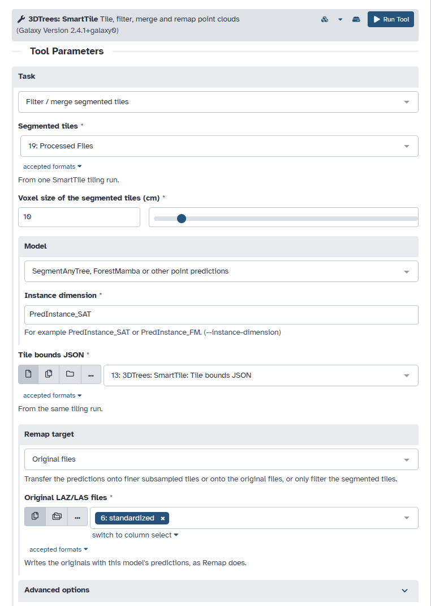
>
>    The result, `Originals with predictions`, is file D at full resolution with both predictions
>    added. In our run this step took about 50 minutes.
>
{: .hands_on}

## Inspect the result in Potree

Potree shows the point cloud in 3D in your browser, so you can rotate and zoom to check the
predicted trees: are there missed trees, trees joined together, or trees split into pieces?

> <hands-on-title>Create and open the interactive view</hands-on-title>
>
> 1.  with the following parameters:
>    -  *"Point Cloud Files"*: `Originals with predictions` (output of **3DTrees: SmartTile** )
>    - *"Generate interactive Viewer"*: `Yes`
>    - *"Special Coloring"*: `Enabled`
>        - *"Special Coloring Instance Attributes"*: `PredInstance_SAT`
>        - *"Write Special Coloring JSON"*: `Yes`
>
>    Tree identifiers are just numbers, so neighbouring trees would get almost the same colour.
>    **Special Coloring** adds `coloring_id_sat`, which gives nearby trees clearly different colours.
>
> 2. Open the **Potree Visualization** output with its  eye icon. Loading can
>    take a minute. Each predicted tree has its own colour; points that belong to no tree are grey.
>
>    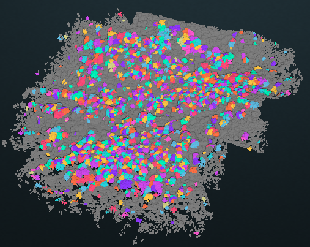
>
> 3. Look at a few neighbouring trees from above and from the side, for example around close-ups A
>    and B. To see the vegetation/non-vegetation classes instead, open **Scene** in the menu on the left, click
>    the point cloud `potree-vis`, and set **Attribute** to `PredSemantic_SAT`.
>
>    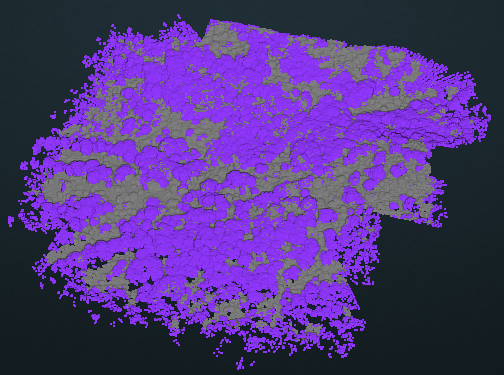
>
{: .hands_on}



> <solution-title>Does the segmentation look plausible?</solution-title>
>
> Colours that follow single crowns and differ between neighbours, and ground in the non-vegetation class,
> suggest a good result. Straight cuts along tile borders or one colour across several crowns
> suggest errors. A plausible picture is not proof, though: measuring accuracy needs trees that were
> labelled independently, for example in the field.
>
{: .solution}

# Next steps

The tree labels are a starting point for measuring tree height, crown size or tree density. Other
3Dtrees tools in Galaxy go further:

- 
  is an alternative tree segmentation model that also separates leaves from wood.
- 
  predicts the species of segmented trees, within the classes it was trained on.

# Conclusion

You turned one drone LiDAR file into a point cloud in which every point carries a predicted class
and, for tree points, a tree identifier, and you checked the result in 3D. The predictions depend
on forest type, point density and survey method, so always inspect them before using them for
ecological analysis.

# Acknowledgements

This work is part of the collaboration between the EOSC node Data Terra and NFDI4Earth.

{: style="width: 200px; max-width: 100%;"}
{: style="width: 140px; max-width: 100%;"}
{: style="width: 200px; max-width: 100%;"}
