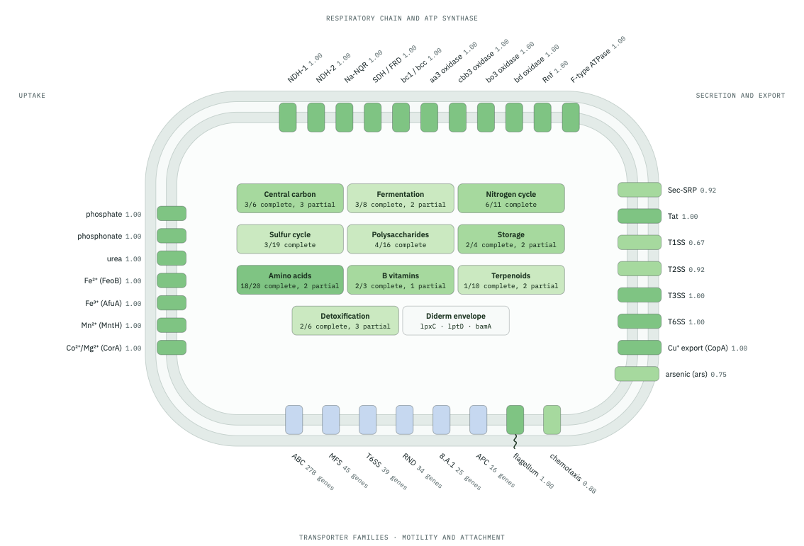
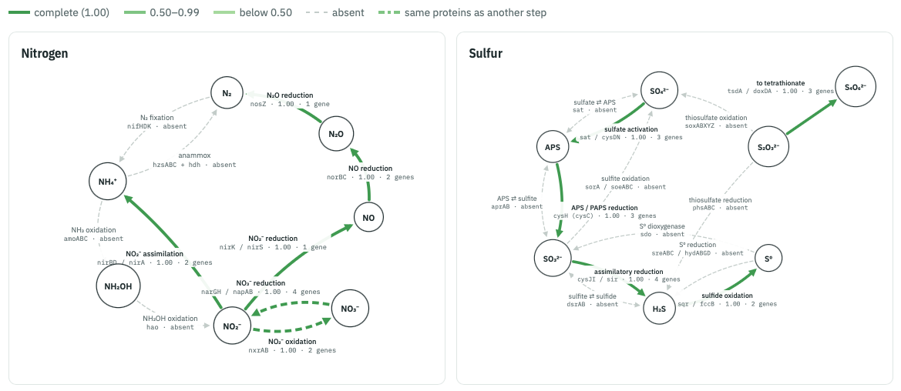

A bacterial proteome contains thousands of proteins. When a new bacterial genome is sequenced, we can annotate its proteins with **eggNOG-mapper** , which predicts their functions through annotation transfer from orthologous proteins in the eggNOG database . **Eggsplorer**  can summarize the resulting annotations in an interactive report.

This tutorial uses the proteome of *Pseudomonas aeruginosa* PAO1 , assembly `GCF_000006765.1`, to demonstrate protein retrieval, functional annotation and report interpretation in Galaxy.

For an introduction to protein annotation, see [Functional annotation of protein sequences]().

> <agenda-title></agenda-title>
>
> 1. TOC
> {:toc}
>
{: .agenda}

# Retrieve the protein sequences

The **NCBI Datasets Genomes** tool  retrieves the protein sequences using the assembly accession.

> <hands-on-title>Download the PAO1 proteome</hands-on-title>
>
> 1. Create a new history for this tutorial and give it a name, for example `Eggsplorer PAO1`
>
>    
>
> 2.  with the following parameters:
>    - In *"Query"*:
>        - *"Choose how to find genomes to download"*: `By NCBI assembly or BioProject accession`
>            - *"Enter accession or read from file ?"*: `Enter accessions`
>                - *"Enter comma separated list of accessions"*: `GCF_000006765.1`
>    - In *"Output options"*:
>        - *"Include"*: select only `amino acid sequences (protein)` (deselect `genomic sequence (genome)`)
>        - *"Decompress FASTA"*: `Yes`
>
>    > <comment-title>Outputs</comment-title>
>    > The tool creates a tabular **Data Report** with the assembly metadata and a **collection** `NCBI Genome Datasets: protein fasta` with one element, `GCF_000006765.1`, which holds the protein sequences.
>    {: .comment}
>
> 3. Inspect the **Data Report** and the protein FASTA file
>
{: .hands_on}

> <question-title></question-title>
>
> 1. How many proteins are in the FASTA file?
>
> > <solution-title></solution-title>
> >
> > 1. The example dataset should contains 5479 protein sequences, each introduced by a `>` header.
> >
> {: .solution}
>
{: .question}

> <tip-title>Using the collection</tip-title>
>
> The protein sequences are provided in a collection with one element, `GCF_000006765.1`. Select this collection as input for the next tool.
{: .tip}

# Annotate the proteins

eggNOG-mapper identifies related proteins and transfers functional annotations. These include functional categories, gene names and **KEGG orthologs (KOs)**: identifiers used to group proteins with related functions .

> <hands-on-title>Functional annotation with eggNOG-mapper</hands-on-title>
>
> 1.  with the following parameters:
>    -  *"Fasta sequences to annotate"*: `NCBI Genome Datasets: protein fasta` (output of **NCBI Datasets Genomes** )
>    - *"Version of eggNOG Database"*: select an available version and record it for reproducibility
>    - In *"Output Options"*:
>        - *"Exclude header lines and stats from output files"*: `Yes`
>
>    > <comment-title>Runtime</comment-title>
>    > Runtime depends on the computational resources and workload of the Galaxy server.
>    {: .comment}
>
{: .hands_on}

Use the **annotations** output (`*.emapper.annotations`) for Eggsplorer.

> <question-title></question-title>
>
> 1. Find `nosZ` in the annotations table. Which KO is assigned to it?
>
> > <solution-title></solution-title>
> >
> > 1. `K00376`. The protein is annotated as nitrous oxide reductase. Its role is examined further in the nitrogen cycle section.
> >
> {: .solution}
>
{: .question}

# Create the Eggsplorer report

> <hands-on-title>Create the interactive report</hands-on-title>
>
> 1.  with the following parameters:
>    -  *"eggNOG-mapper annotations"*: the `annotations` output of **eggNOG Mapper** 
>    - *"Sample name"*: `Pseudomonas aeruginosa PAO1` (the title of the report; if left empty, the dataset name is used)
>    - *"Add KofamScan KO assignments as a second source?"*: `No`
>    - *"Number of items in 'top' charts"*: `25`
>    - *"Report language"*: `English`
>    - *"Also output summary tables"*: `Yes`
>
> 2. Open the report with the  icon
>
{: .hands_on}

> <tip-title>If the charts do not appear</tip-title>
>
> Download the HTML report with the  icon and open it in your browser. Galaxy may block the JavaScript needed for the charts. The report can be opened offline.
{: .tip}

The **summary tables** contain counts and scores for further analysis in Galaxy.

# Explore the Eggsplorer report

The answers below refer to the PAO1 report generated with Eggsplorer 1.1.0. Results may vary with the protein annotation and eggNOG-mapper database version.

## Overview

The overview summarises protein counts and annotation coverage, defined as the proportion of proteins with an entry in a given annotation field.

> <question-title></question-title>
>
> 1. How many proteins are classified as annotated in the report?
> 2. How many unique KOs were found?
>
> > <solution-title></solution-title>
> >
> > 1. 5163 of 5479 proteins, about 94%. This does not mean that every protein has a known function.
> > 2. 2790 unique KOs, assigned to 3455 proteins. Multiple proteins may share the same KO assignment.
> >
> {: .solution}
>
{: .question}

The taxonomy section shows the taxonomic levels used for annotation transfer. In this report, the most common `max_annot_lvl` is *Gammaproteobacteria* (5300 proteins).

## COG and GO

**COG categories** group proteins by function . Hover over the chart to see the category names and counts.

> <question-title></question-title>
>
> 1. Which COG category has the most proteins?
> 2. Find category E. What does it describe?
>
> > <solution-title></solution-title>
> >
> > 1. S, *Function unknown*, with 1176 proteins. A protein can have a COG assignment while its function remains unknown.
> > 2. *Amino acid transport and metabolism*, with 552 proteins.
> >
> {: .solution}
>
{: .question}

**Gene Ontology (GO)** terms describe biological processes, molecular functions and cellular components. The charts show the most frequent terms in each group.

> <comment-title>GO term frequency</comment-title>
>
> GO term frequency does not establish enrichment. The report summarises annotation counts without statistical comparison against a background set.
{: .comment}

## Cell overview

The cell diagram displays predicted cellular components: respiration at the top, uptake on the left, secretion on the right and motility at the bottom. Darker components have higher completeness scores. The layout is a functional schematic, not a map of subcellular location.

> <question-title></question-title>
>
> 1. Find type I secretion (T1SS). What is the completeness score?
> 2. Open its details. Which KO is missing?
>
> > <solution-title></solution-title>
> >
> > 1. 0.67, based on the detection of two of the three KOs specified in the definition.
> > 2. `K11003`. A missing KO assignment alone does not establish the absence or inactivity of the system.
> >
> {: .solution}
>
{: .question}

## Metabolic functions

This section evaluates functional completeness using KEGG-Decoder definitions . Eggsplorer also provides corrected scores. A score of 1.00 indicates that the detected annotations satisfy the scoring rule for that function.

Click a function to inspect the supporting proteins, detected KOs and gaps.

> <question-title></question-title>
>
> 1. Find *nitrous-oxide reduction*. What is its corrected score and which protein supports it?
> 2. Does a score of 1.00 mean that the reaction is active?
>
> > <solution-title></solution-title>
> >
> > 1. 1.00, supported by `nosZ` (`NP_252082.1`, KO `K00376`).
> > 2. No. It indicates that the required annotation was detected. Gene expression and enzyme activity are not measured in this analysis.
> >
> {: .solution}
>
{: .question}

## Nitrogen and sulfur cycles

The cycle diagrams connect individual functions into pathways. Follow the arrows to examine the gene evidence supporting each step.

> <question-title></question-title>
>
> 1. Trace the pathway from nitrate to nitrogen gas in the nitrogen cycle. Are all four steps supported?
> 2. Find *nitrogen fixation* in the metabolic function details. Were any of its required KOs found?
>
> > <solution-title></solution-title>
> >
> > 1. Yes. Nitrate reduction, nitrite reduction, nitric oxide reduction and nitrous-oxide reduction all have corrected scores of 1.00. Together they support a prediction of complete denitrification.
> > 2. No. Its score is 0, with no assignments for the required nitrogenase KOs. Nitrogen fixation and denitrification are different processes.
> >
> {: .solution}
>
{: .question}

> <comment-title>Interpretation of shared KO assignments</comment-title>
>
> Nitrite oxidation also has a score of 1.00. However, the report identifies shared KOs (`K00370`, `K00371`) with nitrate reductase. These assignments alone cannot distinguish the physiological roles of the proteins.
{: .comment}

In the sulfur diagram, the inner route from sulfate to sulfide represents **assimilatory sulfate reduction**, which supplies reduced sulfur for biosynthesis. This pathway does not establish a capacity for sulfate respiration.

## Transporters, enzymes and protein families

The remaining sections group transporters (TC), enzymes (EC), carbohydrate-active enzyme families (CAZy) and protein domains (Pfam). Hover over the charts to inspect their labels and counts.

> <question-title></question-title>
>
> 1. Which transporter family has the most proteins?
> 2. Which Pfam domain is most frequent?
>
> > <solution-title></solution-title>
> >
> > 1. The ATP-binding cassette (ABC) superfamily, `3.A.1`, with 278 proteins.
> > 2. `HTH_1`, with 122 proteins.
> >
> {: .solution}
>
{: .question}

## Examine individual protein annotations

The searchable gene table links the report summaries to individual protein annotations.

> <question-title></question-title>
>
> 1. Search for `nosZ`. What EC number does it have?
>
> > <solution-title></solution-title>
> >
> > 1. `1.7.2.4`. This is the same protein used in the nitrous-oxide reduction example.
> >
> {: .solution}
>
{: .question}

# Conclusion

This workflow combines proteome retrieval, eggNOG-mapper annotation and functional profiling with Eggsplorer. Predicted functions should be interpreted alongside their supporting protein annotations. The report describes genomic functional potential rather than activity under specific biological conditions.

> <comment-title>Citing Eggsplorer</comment-title>
>
> Cite Eggsplorer  and eggNOG-mapper  when using these tools. For metabolic function scores, also cite KEGG-Decoder  and KEGG ; for the CAZy-by-substrate chart, dbCAN3 .
{: .comment}
