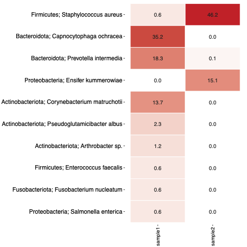
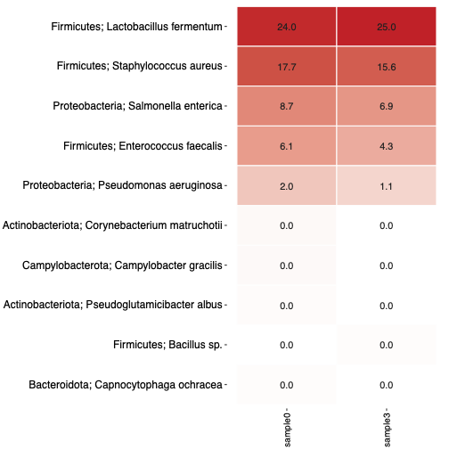
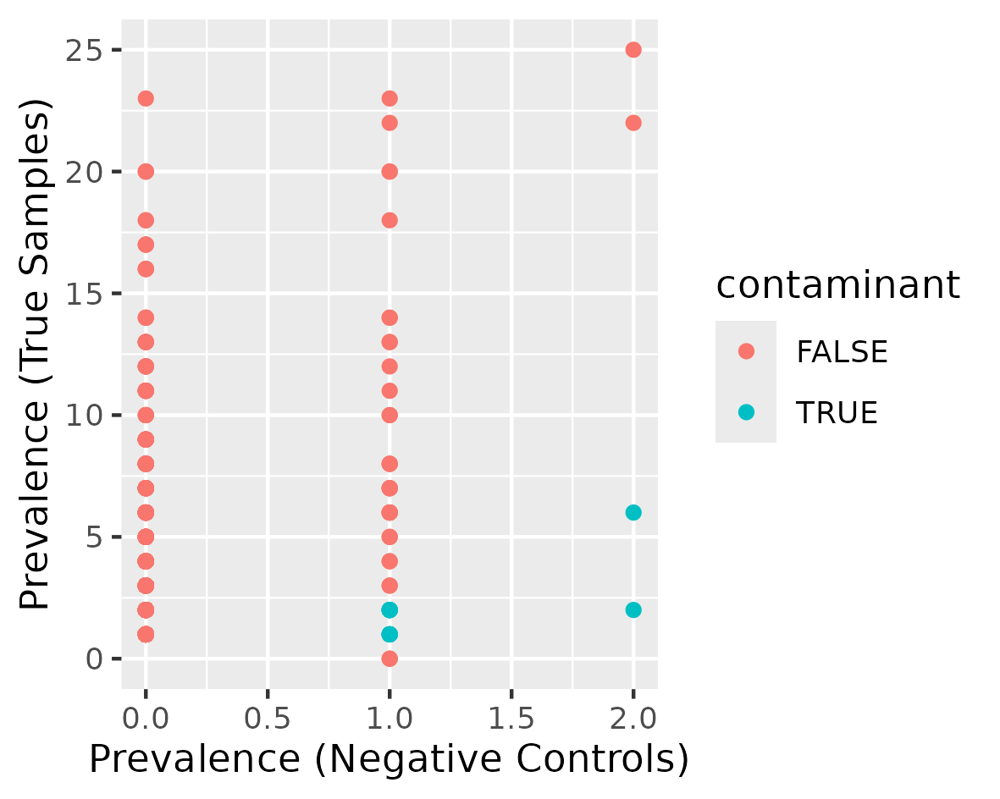
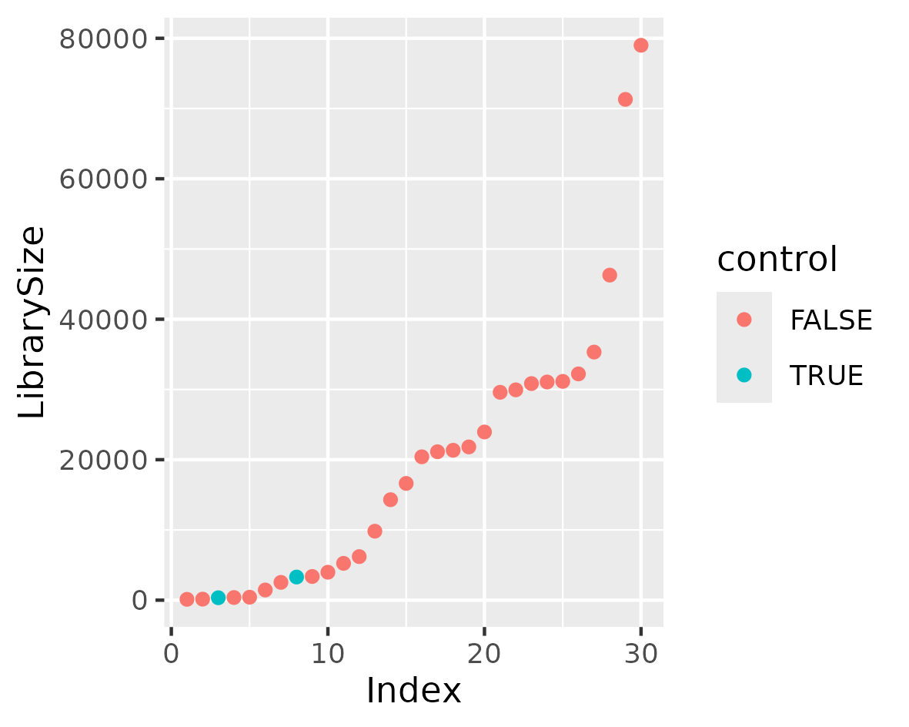
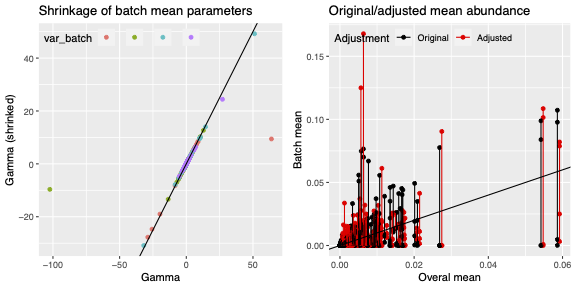

Amplicon sequencing generates reads from microbial marker genes.
Upstream processing converts these reads into an abundance table
of amplicon sequence variants (ASVs), together with their
taxonomic assignments.

Downstream processing helps identify potential contamination
and assess technical variation before further analysis.

This tutorial starts with a phyloseq object
 containing abundance and taxonomy data,
and a matching sample metadata table.

We will inspect the negative and positive controls, identify potential 
contaminants with Decontam, remove the control samples, and correct the 
batch effects with MMUPHin .

> <comment-title>Sources</comment-title>
>
> This tutorial builds upon [Building an amplicon sequence variant (ASV) table from 16S data using DADA2](https://training.galaxyproject.org/training-material/topics/microbiome/tutorials/dada-16S/tutorial.html) 
>
{: .comment}

Association analysis with MaAsLin3 will be covered in a separate
tutorial using the decontaminated, control-filtered data before
MMUPHin correction. MaAsLin3 is not included in the accompanying
workflow.

The main outputs covered here are a decontaminated, control-filtered
phyloseq object, a batch-corrected phyloseq object, and diagnostic plots.

> <agenda-title></agenda-title>
>
> In this tutorial, we will cover:
>
> 1. TOC
> {:toc}
>
{: .agenda}

# Understanding the input data

The workflow requires two input datasets:

- A **phyloseq object** containing ASV or OTU abundances and taxonomic
  assignments.
- A **metadata table** containing sample identifiers and the variables
  needed for quality control and downstream analysis.

Sample identifiers must match between the phyloseq object and the
metadata table.

The workflow expects seven taxonomic ranks in the following order:
Kingdom, Phylum, Class, Order, Family, Genus, and Species.

Negative-control, positive-control, and batch information are supplied
by specifying their column numbers in the metadata table.
Column numbers start at **1**. Enter **0** when the corresponding
column is not provided.

For this example, the `batch` column contains artificial labels
taken from the sampling-site information. These labels are used
only to demonstrate the batch-correction steps.

When no negative-control column is provided, the workflow skips Decontam.
When no batch column is provided, it skips MMUPHin batch correction.

## Example dataset
The example is a subset of the data described in
[Bacterial microbiota similarity between predators and prey in
a blue tit trophic network](https://doi.org/10.1038/s41396-020-00836-3).

The dataset contains 30 samples: 26 biological samples
(13 from female hosts and 13 from male hosts), two negative
controls, and two positive controls. 

The metadata were adapted for this tutorial, including artificial
batch labels copied from the sampling-site information.

# Importing the data into Galaxy
We will use a phyloseq object and its matching sample metadata table.

> <hands-on-title>Import the input datasets</hands-on-title>
>
> 1. Create a new history and name it
>    `Amplicon decontamination and batch correction`.
> 2. Upload the phyloseq object and the metadata table.
> 3. Rename the datasets to:
>    - `Phyloseq object`
>    - `Sample metadata`
> 4. Check the dataset datatypes:
>    - `phyloseq` for the phyloseq object
>    - `tabular` for the metadata table
> 5. Inspect the metadata table using Galaxy's dataset preview.
>    Identify the sample identifier, negative-control,
>    positive-control, and batch columns.
>
{: .hands_on}

> <question-title>Inspect the metadata</question-title>
>
> 1. Which columns identify negative and positive controls?
> 2. Which column contains the (artificial) batch labels?
> 3. Why must sample identifiers match those in the phyloseq object?
>
> > <solution-title></solution-title>
> >
> > 1. `negative_control` is column 13 and `positive_control`
> >    is column 14. A value of `1` identifies the corresponding
> >    control type.
> > 2. `batch` is column 11. In this dataset it duplicates `site` and does not
> >    represent documented real technical batches.
> > 3. Matching identifiers ensure that abundance data are
> >    associated with the correct sample metadata.
> >
> {: .solution}
>
{: .question}

# Preparing the data for control inspection
First, we assign taxonomy rank names to the phyloseq object.
We then load it into ampvis2  together with the sample metadata.

> <hands-on-title>Prepare the taxonomy rank names</hands-on-title>
>
> 1. Run  with:
>    - Input: `Phyloseq object`
>    - Rank names: `Kingdom,Phylum,Class,Order,Family,Genus,Species`
> 2. Rename the output to `Phyloseq with taxonomy names`.
>
{: .hands_on}

> <hands-on-title>Load the data into ampvis2</hands-on-title>
>
> 1. Run  with:
>    - Abundance input: `Phyloseq with taxonomy names`
>    - Metadata: `Sample metadata`
>    - *Guess metadata column types*: `Yes`
>    - *Remove singleton OTUs*: `No`
>    - *Output list data sets*: `Taxonomy list` and `Metadata list`
> 2. Leave the separate taxonomy table, FASTA file, and
>    phylogenetic tree inputs empty.
> 3. Rename the main output to `Ampvis2 data before decontamination`.
> 4. Rename the list outputs to:
>    - `Taxonomy list before decontamination`
>    - `Metadata list before decontamination`
>
{: .hands_on}

# Inspecting negative and positive controls
Negative controls contain no intentionally added biological material.
They help detect contamination introduced during laboratory processing.

Positive controls contain reference material. They help assess whether
processing recovers the expected community, provided its composition
is known.

Control columns must contain integer values: `1` if the sample
is a control of the corresponding type, and `0` otherwise.

> <hands-on-title>Select the negative controls</hands-on-title>
>
> 1. Run  with:
>    - Data: `Ampvis2 data before decontamination`
>    - Metadata list: `Metadata list before decontamination`
>    - Variable: `negative_control`
>    - Value: `1`
>    - Invert selection: `No`
>    - Normalise: `No`
>    - Minimum reads: `0`
> 2. Rename the main output to
>    `Negative controls before decontamination`.
> 3. Rename the metadata list to
>    `Negative-control metadata list`.
>
{: .hands_on}

This subset is used for control inspection. The complete dataset,
including biological samples and controls, is retained for Decontam.

> <hands-on-title>Visualize the negative controls</hands-on-title>
>
> 1. Run  with:
>    - Data: `Negative controls before decontamination`
>    - Metadata list: `Negative-control metadata list`
>    - Taxonomic aggregation: `Species`
>    - Additional taxonomic rank: `Phylum`
>    - Number of taxa shown: `10`
>    - Minimum abundance: `0`
>    - Normalise: `Yes`
>    - Colour scale: `sqrt`
>    - Show values: `Yes`
>    - Output format: `pdf`
> 2. Leave grouping and faceting empty.
>
{: .hands_on}



> <question-title>Inspect the negative-control heatmap</question-title>
>
> 1. Which taxon has the highest relative abundance in each control?
> 2. Do the two controls show similar community profiles?
> 3. Is detection in a negative control sufficient to classify
>    a feature as a contaminant?
>
> > <solution-title></solution-title>
> >
> > 1. Among the displayed taxa, Capnocytophaga ochracea has the
> >    highest relative abundance in sample1 (35.2%), whereas
> >    Staphylococcus aureus dominates sample2 (46.2%).
> > 2. The profiles differ substantially. Several taxa are abundant
> >    in one control but absent or present at low relative abundance
> >    in the other.
> > 3. No. The heatmap highlights taxa for further investigation.
> >    Decontam evaluates individual features using their occurrence
> >    in negative controls and biological samples.
> >
> {: .solution}
>
{: .question}

> <hands-on-title>Inspect the positive controls</hands-on-title>
>
> 1. Run  on
>    `Ampvis2 data before decontamination`, using
>    `Metadata list before decontamination`:
>    - Variable: `positive_control`
>    - Value: `1`
>    - Invert selection: `No`
>    - Normalise: `No`
>    - Minimum reads: `0`
> 2. Rename the main output to
>    `Positive controls before decontamination`.
> 3. Rename the metadata list to `Positive-control metadata list`.
> 4. Run  using these two outputs and the
>    same settings as for the negative-control heatmap.
>
{: .hands_on}



Displayed values are rounded. A value of `0.0` does not
necessarily indicate complete absence.

> <question-title>Inspect the positive-control heatmap</question-title>
>
> 1. Which taxon has the highest displayed relative abundance?
> 2. How similar are the profiles of the two positive controls?
> 3. Can this heatmap alone confirm the expected control composition?
>
> > <solution-title></solution-title>
> >
> > 1. Lactobacillus fermentum has the highest displayed relative
> >    abundance: 24.0% in sample0 and 25.0% in sample3.
> > 2. The dominant displayed taxa have similar relative abundances
> >    in both controls, although their proportions are not identical.
> > 3. No. Assessing agreement with the expected composition requires
> >    information about the positive-control material.
> >
> {: .solution}
>
{: .question}

# Identifying and removing contaminants
Decontam  uses the negative-control samples to identify potential contaminants 
in the data. 
It produces diagnostic plots and a decontaminated phyloseq object.

> <hands-on-title>Export the complete dataset for Decontam</hands-on-title>
>
> 1. Run  with:
>    - Data: `Ampvis2 data before decontamination`
>    - Normalisation: `No`
>    - Outputs: `OTU short`, `Taxonomy`, `Metadata`, `Phyloseq`
> 2. Rename the phyloseq output to
>    `Phyloseq before decontamination`.
>
{: .hands_on}

Use the complete dataset, including biological samples and
both control types, rather than either control subset.

> <hands-on-title>Run Decontam</hands-on-title>
>
> 1. Run  with:
>    - Input type: `Phyloseq`
>    - Phyloseq object: `Phyloseq before decontamination`
>    - Control metadata column: `negative_control`
>    - Threshold: `0.1`
> 2. Rename the output phyloseq object to
>    `Phyloseq after decontamination`.
> 3. Inspect the diagnostic plots.
>
{: .hands_on}

Control samples are retained at this stage and will be removed
after inspecting the results of decontamination.

# Assessing the results of decontamination





> <question-title>Interpret the Decontam diagnostics</question-title>
>
> 1. What do the axes and colours in the prevalence plot represent?
> 2. How do the library sizes of negative controls compare with
>    those of the other samples?
> 3. How many features were classified as potential contaminants?
>
> > <solution-title></solution-title>
> >
> > 1. Each point represents a feature. The x-axis shows the number
> >    of negative controls containing it; the y-axis shows the
> >    number of samples not marked as negative controls containing it.
> >    Turquoise indicates a potential contaminant and red indicates
> >    a feature not classified as a contaminant.
> >    Multiple features can overlap at the same coordinates.
> > 2. Both negative controls have relatively low library sizes.
> >    However, some other samples also have low library sizes.
> >    Library size alone is insufficient to identify contaminants.
> > 3. The job log reports 14 potential contaminant features.
> >
> {: .solution}
>
{: .question}

The complete workflow also generates additional heatmaps and
ordination plots after decontamination. These optional diagnostic
outputs are not covered in this tutorial.

# Removing control samples
After decontamination, the workflow removes negative- and positive-control 
samples from the data.
Decontam removes potential contaminant features. We now remove
the control samples, retaining only biological samples for
downstream analysis.

> <hands-on-title>Load the decontaminated data</hands-on-title>
>
> 1. Run  with:
>    - Abundance input: `Phyloseq after decontamination`
>    - Metadata: leave empty; metadata are contained in the object
>    - Remove singleton OTUs: `No`
>    - Output list data sets: `Taxonomy list` and `Metadata list`
> 2. Rename the main output to `Ampvis2 data after decontamination`.
> 3. Rename the metadata list to
>    `Metadata list after decontamination`.
>
{: .hands_on}

> <hands-on-title>Remove control samples</hands-on-title>
>
> 1. Run  with:
>    - Data: `Ampvis2 data after decontamination`
>    - Metadata list: `Metadata list after decontamination`
>    - Variable: `negative_control`
>    - Value: `0`
>    - Invert selection: `No`
>    - Normalise: `No`
>    - Minimum reads: `0`
> 2. Repeat  using the main output
>    and metadata list from step 1:
>    - Variable: `positive_control`
>    - Value: `0`
>    - Keep the other settings unchanged.
> 3. Rename the final main output to
>    `Ampvis2 data without controls`.
>
{: .hands_on}

# Exporting data for downstream analysis
The workflow outputs a decontaminated, control-filtered phyloseq object for 
downstream analysis.

> <hands-on-title>Export the analysis-ready data</hands-on-title>
>
> 1. Run  with:
>    - Data: `Ampvis2 data without controls`
>    - Normalisation: `No`
>    - Outputs: `OTU short`, `Taxonomy`, `Metadata`, `Phyloseq`
> 2. Rename the outputs to:
>    - OTU short: `ASV table before batch correction`
>    - Taxonomy: `Taxonomy`
>    - Metadata: `Metadata without controls`
>    - Phyloseq: `Analysis-ready phyloseq`
> 3. Inspect the exported metadata. Confirm that 26 samples remain
>    and both control indicators contain only `0`.
>
{: .hands_on}

# Correcting batch effects with MMUPHin
> <warning-title>Artificial batch labels for demonstration</warning-title>
>
> This dataset has no documented technical batches.
> For demonstration purposes, an artificial `batch` column was
> added by copying the sampling-site labels.
>
> We use this column to demonstrate the batch-correction branch
> of the workflow. Because these labels represent sampling sites,
> correction may remove biological differences between sites.
> The resulting data and diagnostic plots must therefore not be
> interpreted as evidence of successful technical batch correction.
>
> For your own analysis, use documented technical batch information.
>
{: .warning}

Batch effects are systematic differences introduced by technical
processing, such as different extraction dates or sequencing runs.

Here, we demonstrate adjustment with MMUPHin using the artificial
batch labels described above. MMUPHin produces an adjusted
abundance table and diagnostic plots. We subsequently reconstruct
a phyloseq object from the adjusted table.

> <hands-on-title>Run MMUPHin batch correction</hands-on-title>
>
> 1. Run  with:
>    - Input data: `ASV table before batch correction`
>    - Input metadata: `Metadata without controls`
>    - Batch column: `11` (the artificial `batch` column;
>      verify its position in the exported metadata)
>    - Covariates: leave empty
>    - Zero inflation: `Yes`
>    - Convergence tolerance: `0.0001`
>    - Maximum iterations: `1000`
>    - Diagnostic plot: `Yes`
> 2. Rename the corrected abundance table to
>    `MMUPHin corrected ASV table`.
> 3. Inspect the diagnostic plot.
>
{: .hands_on}

# Inspecting batch correction results
Inspect the diagnostic plot to examine how correction changes
the differences between the artificial groups. A reduction in
these differences does not demonstrate successful removal of
technical variation, because the groups represent sampling sites.



> <question-title>Inspect the MMUPHin diagnostics</question-title>
>
> 1. What does the left panel show?
> 2. What do the black and red points in the right panel represent?
>
> > <solution-title></solution-title>
> >
> > 1. The left panel compares original and shrunken batch mean
> >    parameters. Many change little, while some extreme estimates
> >    are pulled towards zero.
> > 2. Black points represent original batch mean abundances;
> >    red points represent adjusted batch mean abundances.
> >
> {: .solution}
>
{: .question}

# Exporting the corrected phyloseq object

We combine the corrected abundance table with the taxonomy and
sample metadata to reconstruct a phyloseq object.

> <hands-on-title>Reconstruct and export the corrected data</hands-on-title>
>
> 1. Inspect the header of `MMUPHin corrected ASV table`.
>    If it starts directly with the first sample name and lacks
>    a field for the ASV identifier column, run 
>    on this table with:
>
>    ```awk
>    NR == 1 { print "ASV\t" $0; next }
>    { print }
>    ```
>
> 2. Run  with:
>    - Abundance table: the corrected table with its ASV header
>    - Metadata: `Metadata without controls`
>    - Taxonomy table: `Taxonomy`
>    - Remove singleton OTUs: `No`
>    - Output list data sets: `Taxonomy list` and `Metadata list`
> 3. Run  on the new ampvis2 output:
>    - Normalisation: `No`
>    - Output: `Phyloseq`
> 4. Rename the output to `MMUPHin corrected phyloseq`.
>
{: .hands_on}

The corrected abundances are adjusted values and should not
be interpreted as the original sequencing read counts.

# Running the complete workflow

In this tutorial, we performed the analysis step by step.
The accompanying workflow automates these steps, starting
from the phyloseq object and sample metadata.

> <hands-on-title>Run the workflow</hands-on-title>
>
> 1. Import the accompanying workflow from the workflow
>    section of this tutorial.
> 2. Run it in a new history using the original input datasets:
>    - Phyloseq object: `Phyloseq object`
>    - Metadata: `Sample metadata`
> 3. Set the workflow parameters:
>    - Negative-control column number: `13`
>    - Positive-control column number: `14`
>    - Batch-ID column number: `11`
>    - Decontam threshold: `0.1`
> 4. Inspect the workflow outputs and compare them with
>    the results obtained by running the tools individually.
>
{: .hands_on}

The artificial batch labels are used only to demonstrate
the MMUPHin branch, as explained above.

# Conclusion
The workflow provides a downstream analysis of amplicon data, 
including decontamination, control removal, and batch effect correction. 