Breast tumours are mixtures of malignant epithelial cells, fibroblasts, vascular cells and infiltrating immune populations, and the location of those populations can be as informative as their expression state (, ). Spatial transcriptomics (ST) preserves that positional information, making it possible to ask whether expression programmes form coherent territories, meet at interfaces or avoid one another (, ). Applied to breast tumours, the same approach has been used to show that regions of one tumour can differ enough to matter clinically ().

This tutorial uses the 10x Genomics **Human Breast Cancer, Block A Section 1** dataset . 10x Genomics obtained fresh-frozen invasive ductal carcinoma tissue, cryosectioned it at 10 µm onto a Visium Gene Expression slide and imaged the section with haematoxylin and eosin (H&E) before library preparation. The sample is described as AJCC/UICC Stage Group IIA, ER positive, PR negative and HER2 positive, and the section is annotated as containing **ductal carcinoma *in situ*, lobular carcinoma *in situ* and invasive carcinoma**. This tutorial uses the Space Ranger 1.1.0 release of the dataset, which reports 3,798 spots under tissue and quantifies 36,601 genes.

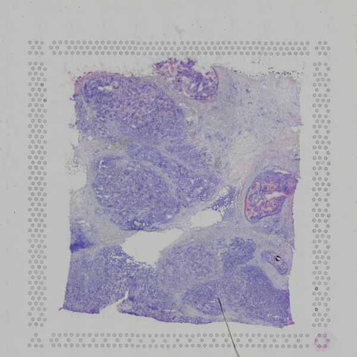

The expression table entering this analysis contains **3,798 observations and 36,601 genes**.


The unit of measurement matters throughout this tutorial. In the original 10x Genomics Visium Gene Expression platform, each observation represents a **capture spot rather than a segmented cell**. The spots are 55 µm in diameter, with 100 µm between their centres, and are arranged in a fixed hexagonal lattice. Depending on the cellular density and tissue architecture, a spot may capture RNA from approximately one to ten cells, although the number and composition vary between tissue regions (). Consequently, the expression profile of an individual spot can contain transcripts from several cell populations.

This distinction shapes how the results should be interpreted. **Leiden clustering groups spots according to transcriptional similarity**, using the expression-neighbour graph constructed by Scanpy. A Leiden group therefore represents an **expression-defined group of capture spots**, not necessarily a single cell type or a spatially continuous tissue compartment. Whether its members occupy coherent regions, occur at tissue interfaces or are distributed across the section must be investigated using their spatial coordinates and the histological image (, ).

The same caution applies to downstream annotation and interaction analysis. CellTypist compares each mixed spot expression profile with labelled single-cell references and assigns the closest reference category; this does not reveal the proportions or exact identities of the cells contributing RNA to that spot (). LIANA uses expression associated with the selected Leiden groups to prioritise candidate ligand-receptor relationships, but these rankings do not demonstrate direct cellular contact, receptor activation or functional signalling (). Throughout this tutorial, biological interpretations are therefore based on the combined evidence from marker genes, spatial organisation, reference annotations and tissue morphology, while recognising the multicellular resolution of Visium.


> <comment-title>Why this pipeline has no doublet detection and no deconvolution step</comment-title>
>
> Two steps that are routine in single-cell tutorials are deliberately absent here, and both omissions follow from the size of a capture spot.
>
> **Doublet detection is not applicable.** Tools such as Scrublet look for droplets that accidentally captured two cells, because in droplet-based single-cell RNA-seq a two-cell measurement is a technical artefact (). A Visium spot is multicellular *by design*, so flagging multicellular spots would discard valid data rather than clean it.
>
> **Deconvolution is not run.** Methods such as cell2location and RCTD estimate the contributions of different cell populations to spatial transcriptomics measurements by using expression signatures derived from a single-cell or single-nucleus reference (, ). An appropriate reference should represent the relevant tissue and cell populations, but it does not necessarily have to come from the same specimen.
>
> Deconvolution is a separate analytical task requiring reference selection, compatibility checks and assessment of uncertainty. It is not included in this tutorial. Consequently, the Leiden groups below are interpreted as expression-defined tissue programmes, while CellTypist predictions are treated as closest reference matches rather than estimates of cell-type proportions.
>
{: .comment}


The prepared SpatialData input and supporting analysis outputs are available from the [Zenodo record]({{ page.zenodo_link }}). A [reference Galaxy history](https://usegalaxy.eu/u/khaled196/h/spatial-transcriptomics-analysis-of-the-breast-cancer-tumour-microenvironment-with-visium-1) provides a worked example of the analysis. Throughout the tutorial, reported dimensions, quality-control summaries, marker-gene rankings and spatial statistics provide checkpoints for interpreting the results generated at each stage. Comparing these outputs with the reference analysis helps assess reproducibility while keeping the biological interpretation grounded in the observed data.




> <agenda-title></agenda-title>
>
> In this tutorial, we will cover:
>
> 1. TOC
> {:toc}
>
{: .agenda}

# Analysis strategy


| Analysis stage | Question it answers | Main output |
| --- | --- | --- |
| SpatialData input and extraction | How are Visium expression measurements, spot positions and tissue images represented together? | SpatialData object and extracted AnnData table |
| QC before filtering | How do total counts and detected genes vary across spots, and where are low-information spots located? | Per-spot QC metrics, distribution plots and spatial QC maps |
| Spot and gene filtering | How do the selected thresholds affect the numbers of spots and genes retained? | Filtered AnnData object and updated matrix dimensions |
| QC after filtering | How have filtering steps changed the QC distributions and spatial coverage of the tissue? | Recalculated QC metrics, distribution plots and spatial QC maps |
| Normalisation and HVG selection | How can differences in total counts be adjusted, and which genes are selected as highly variable? | Log-normalised AnnData, HVG annotations and variability plot |
| PCA and optional regression | How is PCA structure associated with total counts, and what changes after regressing out this covariate? | PCA on non-regressed expression and optional PCA after total-count regression |
| Expression graph, UMAP and Leiden | Which spots have similar expression profiles, and how do Leiden partitions change with resolution? | Expression-neighbour graph, UMAP embedding and alternative Leiden partitions |
| Marker gene ranking | Which genes distinguish the selected Leiden groups, and what tissue programmes do they suggest? | Wilcoxon-ranked gene table, marker plots and marker-based interpretation |
| Squidpy spatial analysis | How are Leiden groups organised across the tissue, and which genes show spatial autocorrelation? | Spatial-neighbour graph, centrality scores, neighbourhood enrichment, Moran's I and gene-expression map |
| CellTypist reference annotation | Which adult-breast reference profiles most closely match the expression measured in each Visium spot? | Direct reference-label predictions, prediction scores and dot plot |
| LIANA ligand-receptor analysis | Which ligand-receptor pairs are ranked from expression profiles within and between Leiden groups? | Candidate ligand-receptor rankings stored in `liana_res` |
| SpatialData output | Where are the selected transcriptomic groups located on the tissue section? | Processed SpatialData object and Leiden-group overlay on the histology |

# Get the data

The tutorial starts from `V1_Breast_Cancer_Block_A_Section_1.spatialdata.zip`. SpatialData holds the histology image, the Visium spot geometry, the coordinate system relating them and the annotated expression table in a single object, so the alignment between expression and tissue survives every operation applied to it ().

> <hands-on-title>Data upload</hands-on-title>
>
> 1. Create a new Galaxy history and name it `Visium breast cancer TME`.
>
>    
>
>    
>
> 2. Import the prepared SpatialData object from [Zenodo]({{ page.zenodo_link }}):
>
>    ```
>    {{ page.zenodo_link }}/files/V1_Breast_Cancer_Block_A_Section_1.spatialdata.zip
>    ```
>
>    
>
> 3. Confirm that Galaxy assigns the datatype `spatialdata.zip`.
>
>    
>
{: .hands_on}

## What the SpatialData object represents

Visium measures expression at printed capture spots rather than at segmented cells. This is the defining difference between sequencing-based spatial transcriptomics and the imaging-based platforms, such as Xenium, MERSCOPE and CosMx, which localise individual transcripts and assign them to cell boundaries drawn from a stain. Imaging-based data therefore arrive as cells with morphology measurements attached, while Visium data arrive as a fixed grid of multicellular areas. The trade-off runs the other way for gene coverage: Visium captures the whole polyadenylated transcriptome, whereas imaging platforms read a targeted panel.

Inside the object, that distinction appears in which elements exist. The capture spots are stored as **shapes**, circles of fixed radius registered to the tissue image, and the table holds the expression matrix and per-spot annotation. There is no labels element, because no segmentation was performed.

> <details-title>Optional: build the SpatialData object from the Space Ranger files</details-title>
>
> This tutorial starts from a prepared `.spatialdata.zip` object, so this section is not needed to follow the analysis. It is here because assembling that object is the step most often required when you bring your own Visium data, and the files that went into it are on the same record.
>
> Space Ranger writes a `spatial/` folder alongside the count matrix, and **SpatialData IO** reads the two together into a single object. Each input supplies a different part of it:
>
> | Space Ranger file | What it contributes |
> | --- | --- |
> | `filtered_feature_bc_matrix.h5` | The count matrix, restricted to barcodes Space Ranger judged to be under tissue |
> | `tissue_positions_list.csv` | Array row and column, and the full-resolution pixel coordinates of every spot |
> | `scalefactors_json.json` | Spot diameter in full-resolution pixels, and the factors that rescale coordinates onto the downsampled images |
> | `V1_Breast_Cancer_Block_A_Section_1_image.tif` | The full-resolution H&E image |
> | `tissue_hires_image.png`, `tissue_lowres_image.png` | Downsampled images used for most plotting |
>
> 1. Import the data needed to build the SpatialData object from [Zenodo]({{ page.zenodo_link }}):
>
>    ```
>    {{ page.zenodo_link }}/files/V1_Breast_Cancer_Block_A_Section_1_filtered_feature_bc_matrix.h5
>    {{ page.zenodo_link }}/files/V1_Breast_Cancer_Block_A_Section_1_image.tif
>    {{ page.zenodo_link }}/files/tissue_hires_image.png
>    {{ page.zenodo_link }}/files/tissue_lowres_image.png
>    {{ page.zenodo_link }}/files/tissue_positions_list.csv
>    {{ page.zenodo_link }}/files/scalefactors_json.json
>    ```
>
> 2.  with the following parameters:
>    - *"Spatial Technology"*: `10x Genomics Visium`
>        - *"Dataset identifier"*: `V1_Breast_Cancer_Block_A_Section_1`
>        -  *"feature BC matrix (Counts file)"*: `V1_Breast_Cancer_Block_A_Section_1_filtered_feature_bc_matrix.h5`
>        -  *"Scale factors file"*: `scalefactors_json.json`
>        -  *"Full resolution image"*: `V1_Breast_Cancer_Block_A_Section_1_image.tif`
>        -  *"Tissue high resolution image"*: `tissue_hires_image.png`
>        -  *"Tissue low resolution image"*: `tissue_lowres_image.png`
>        -  *"Tissue positions file"*: `tissue_positions_list.csv`
>
> Two details are worth knowing before you try this on your own data. The **dataset identifier** becomes the prefix of the image, shapes and coordinate-system names, so every later plotting step refers back to whatever you type here. And the filtered matrix, not the raw one, is the right input: the raw matrix contains all 4,992 printed spots including those outside the tissue, while the filtered matrix contains only the spots Space Ranger placed under tissue.
>
> Finally, do not mix files from different Space Ranger versions of the same section. Reprocessing can change which spots are treated as under tissue and which reference annotation was used, so the counts will not match even though the histology is identical.
>
{: .details}

# Extract the expression table

The Scanpy tools work on AnnData, the container that pairs an expression matrix with per-observation and per-gene annotation (), so the first analysis step pulls the `table` element out of the SpatialData object. The object itself stays in the history, because every spatial plot later in this tutorial needs it again.

> <hands-on-title>Export and inspect the AnnData table</hands-on-title>
>
> 1.  with the following parameters:
>    -  *"SpatialData object"*: `V1_Breast_Cancer_Block_A_Section_1.spatialdata.zip`
>    - *"Operation"*: `Export the table of a SpatialData object to anndata`
>        - *"Table name"*: `table`
>
> 2. **Rename**  the generated file `Initial AnnData table`.
>
> 
>
> 3.  with the following parameters:
>    -  *"Annotated data matrix"*: `Initial AnnData table`
>    - *"What to inspect?"*: `General information about the object`
>
>    Rename the text output `Initial AnnData dimensions`.
>
>    > <question-title>Check the dimensions before doing anything else</question-title>
>    >
>    > ```
>    > AnnData object with n_obs × n_vars = 3798 × 36601
>    > ```
>    >
>    > What do the two numbers mean in a Visium experiment, and why should the first not be called a cell count?
>    >
>    > > <solution-title></solution-title>
>    > >
>    > > `n_obs` is the number of capture-spot observations in this prepared table and `n_vars` is the number of genes. A Visium spot covers an area large enough to receive RNA from several cells, so 3,798 observations does not mean 3,798 cells.
>    > >
>    > > Checking these dimensions before filtering also provides the denominator for every removal tally later in the tutorial.
>    > >
>    > {: .solution}
>    >
>    {: .question}
>
{: .hands_on}

# Quality control before filtering

`total_counts` measures the amount of expression signal recorded for each spot, while `n_genes_by_counts` records how many distinct genes are detected. The `pct_counts_in_top_N_genes` columns show how concentrated the counts are in the most abundant genes. A spot with a small detected-gene set and low total counts may be poorly captured, but low RNA can also reflect a genuine tissue region, which is why the same metrics are inspected both as distributions and on the histology.

No mitochondrial or ribosomal gene set is defined here, and no threshold is applied to either. In single-cell work a high mitochondrial fraction flags a dying cell whose cytoplasmic RNA has leaked away. A Visium spot averages over several cells, so the same measurement no longer isolates a failing cell, and a region of genuinely stressed or hypoxic tumour would be penalised for its biology. The metrics below are all count- and complexity-based for that reason.

> <hands-on-title>Compute QC metrics</hands-on-title>
>
> 1.  with the following parameters:
>    -  *"Annotated data matrix"*: `Initial AnnData table`
>    - *"Method used for inspecting"*: `Calculate quality control metrics, using 'pp.calculate_qc_metrics'`
>        - *"Name of kind of values in X"*: `counts`
>        - *"The kind of thing the variables are"*: `genes`
>        - *"Proportions of top genes to cover"*: `50,100,200,300`
>        - *"Use 'raw' attribute of input if present"*: `No`
>        - *"Compute log1p transformed annotations"*: `Yes`
>
> 2. **Rename**  the generated file `QC metrics before filtering`.
>
> 3.  with the following parameters:
>    -  *"Annotated data matrix"*: `QC metrics before filtering`
>    - *"What to inspect?"*: `General information about the object`
>
{: .hands_on}

> <details-title>Optional: read the QC distributions as numbers</hands-on-title>
>
> The scatter and violin plots show the distributions of sequencing depth and detected-gene complexity across spots. To obtain the numerical summaries behind these plots, export the observation annotations and calculate the minimum, median and maximum values for the two QC metrics.
>
> 1.  with the following parameters:
>    -  *"Annotated data matrix"*: `QC metrics before filtering`
>    - *"What to inspect?"*: `Key-indexed observations annotation (obs)`
>
>    This exports one row per capture spot, including `total_counts` and `n_genes_by_counts`.
>
> 2.  with the following parameters:
>    - In *"Database Table"*:
>        -  *"Tabular Dataset for Table"*: the observation table from the previous  step
>        - In *"Table Options"*:
>            - *"Specify Name for Table"*: `obs`
>            - *"Use first line as column names"*: `Yes`
>    - *"SQL Query to generate tabular output"*:
>
>      ```sql
>      SELECT * FROM (
>      WITH ranked AS (
>          SELECT CAST(total_counts AS REAL) AS total_counts,
>                 CAST(n_genes_by_counts AS REAL) AS n_genes_by_counts,
>                 ROW_NUMBER() OVER (
>                     ORDER BY CAST(total_counts AS REAL)
>                 ) AS r_counts,
>                 ROW_NUMBER() OVER (
>                     ORDER BY CAST(n_genes_by_counts AS REAL)
>                 ) AS r_genes,
>                 COUNT(*) OVER () AS n
>          FROM obs
>      )
>      SELECT COUNT(*) AS spots,
>             MIN(total_counts) AS min_total_counts,
>             (SELECT AVG(total_counts)
>              FROM ranked
>              WHERE r_counts IN ((n+1)/2, (n+2)/2)
>             ) AS median_total_counts,
>             MAX(total_counts) AS max_total_counts,
>             MIN(n_genes_by_counts) AS min_n_genes_by_counts,
>             (SELECT AVG(n_genes_by_counts)
>              FROM ranked
>              WHERE r_genes IN ((n+1)/2, (n+2)/2)
>             ) AS median_n_genes_by_counts,
>             MAX(n_genes_by_counts) AS max_n_genes_by_counts
>      FROM ranked
>      ) AS evidence_results;
>      ```
>
>    - *"include query result column headers"*: `Yes`
>        - *"Prefix character for column_header line"*: `#`
>
> The output contains one summary row for the section. Compare the medians with the minimum and maximum values before choosing quality-control thresholds. A low count or detected-gene value may indicate reduced capture efficiency, but it may also reflect a tissue region with low RNA abundance or cellularity.
>
{: .details}


For this section the median `total_counts` is **20,761.5** and the median `n_genes_by_counts` is **6,026.5**. Both distributions are wide: the minimum total count is 578, and the minimum number of detected genes is 430, the strongest 81,624 counts, and the most complex spot detects 10,153 genes. Those two tails are what the filters in the next section act on, and knowing where they sit is what makes a threshold a decision rather than a guess.

> <hands-on-title>Visualise QC metrics</hands-on-title>
>
>
> 1.  with the following parameters:
>    -  *"Annotated data matrix"*: `QC metrics before filtering`
>    - *"Method used for plotting"*: `Generic: Scatter plot along observations or variables axes, using 'pl.scatter'`
>        - *"x coordinate"*: `total_counts`
>        - *"y coordinate"*: `n_genes_by_counts`
>        - *"Color by"*: `pct_counts_in_top_50_genes`
> 2.  with the following parameters:
>    -  *"Annotated data matrix"*: `QC metrics before filtering`
>    - *"Method used for plotting"*: `Generic: Violin plot, using 'pl.violin'`
>        - *"Keys for accessing variables"*: `Subset of variables in 'adata.var_names' or fields of '.obs'`
>            - *"Keys for accessing variables"*: `n_genes_by_counts, total_counts`
>        - In *"Violin plot attributes"*:
>            - *"Display keys in multiple panels"*: `Yes`
>
>
{: .hands_on}

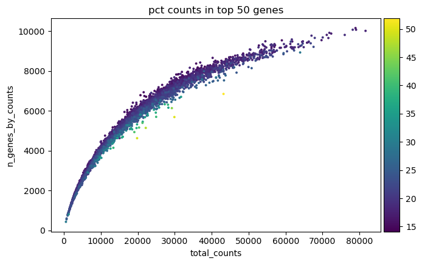

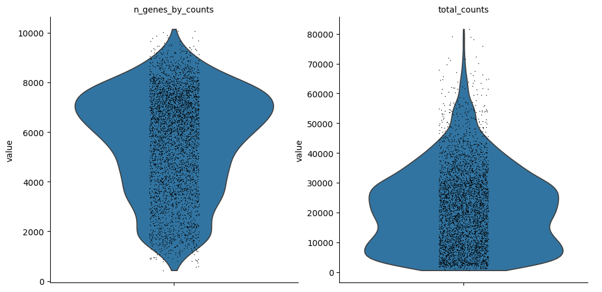


The distributions show how unusual a spot is, but not where it sits. Before removing the tail, map the same QC fields back onto the section.

> <hands-on-title>Map the QC metrics onto histology</hands-on-title>
>
> 1.  with the following parameters:
>    -  *"SpatialData object"*: `V1_Breast_Cancer_Block_A_Section_1.spatialdata.zip`
>    - *"Operation"*: `Import anndata table to a SpatialData object`
>        -  *"annotated data object to add"*: `QC metrics before filtering`
>        - *"Table name"*: `table_qc`
>
> 2.  with the following parameters:
>    -  *"SpatialData object"*: `The SpatialData object from the previous`  `step` 
>    - In *"Render Images"*:
>        - *"Image element name"*: `V1_Breast_Cancer_Block_A_Section_1_hires_image`
>    - In *"Render Shapes"*:
>        - *"Shapes element name"*: `V1_Breast_Cancer_Block_A_Section_1`
>        - *"Color column"*: `total_counts`
>        - *"Scale factor"*: `1.0`
>        - *"Table name"*: `table_qc`
>    - In *"Plot Display Parameters"*:
>        - *"Coordinate system(s)"*: `V1_Breast_Cancer_Block_A_Section_1`
>        - *"Legend location"*: `Right margin`
>        - *"Enable colorbars?"*: `Yes`
>        - *"Image format"*: `JPG`
>
>
> 3.  with the following parameters:
>    -  *"SpatialData object"*: `The SpatialData object from the previous`  `step` 
>    - In *"Render Images"*:
>        - *"Image element name"*: `V1_Breast_Cancer_Block_A_Section_1_hires_image`
>    - In *"Render Shapes"*:
>        - *"Shapes element name"*: `V1_Breast_Cancer_Block_A_Section_1`
>        - *"Color column"*: `n_genes_by_counts`
>        - *"Scale factor"*: `1.0`
>        - *"Table name"*: `table_qc`
>    - In *"Plot Display Parameters"*:
>        - *"Coordinate system(s)"*: `V1_Breast_Cancer_Block_A_Section_1`
>        - *"Legend location"*: `Right margin`
>        - *"Enable colorbars?"*: `Yes`
>        - *"Image format"*: `JPG`
>
>
{: .hands_on}


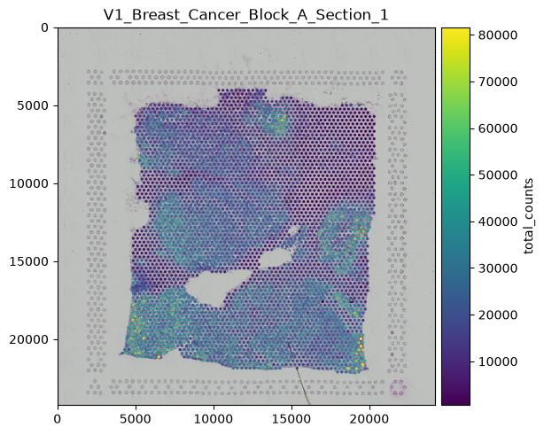


> <question-title>Interpret the QC output</question-title>
>
> 1. Why is `n_genes_by_counts` expected to increase with `total_counts` but not in a perfectly linear way?
> 2. Why is a spatial map useful before removing a low-count tail?
> 3. The minimum is 578 counts, while the later count threshold is 1,000. Does that mean every spot below 1,000 is necessarily a technical failure?
>
> > <solution-title></solution-title>
> >
> > 1. As more transcripts are sampled, an increasing fraction are repeats of genes already detected, so the number of distinct genes does not grow one-for-one with the count total.
> > 2. A low value can be technical, but it can also correspond to tissue with genuinely low RNA abundance or poor cellularity. A spatial map shows whether low values are scattered or associated with a coherent anatomical region that should be reported.
> > 3. No. The threshold is a filtering decision made for this dataset, not a biological definition of failure. A spot below it may sit on sparse stroma or on a tear in the section, and the only way to tell is to look at where the removed spots were.
> >
> {: .solution}
>
{: .question}

# Filtering

Filtering proceeds in two stages: first the spots that carry too little signal to interpret, then the genes that are detected too rarely to contribute. Each step below takes the output of the previous one, and the object is inspected after each stage so that the effect of every threshold is visible rather than assumed.

## Spot filters

> <hands-on-title>Remove spots with very low detected-gene complexity</hands-on-title>
>
> 1.  with the following parameters:
>    -  *"Annotated data matrix"*: `QC metrics before filtering`
>    - *"Method used for filtering"*: `Filter cell outliers based on counts and numbers of genes expressed, using 'pp.filter_cells'`
>        - *"Filter"*: `Minimum number of genes expressed`
>            - *"Minimum number of genes expressed required for a cell to pass filtering"*: `500`
>
>
{: .hands_on}

The tool label says **cell** because `pp.filter_cells` operates on AnnData observations, and Scanpy's vocabulary comes from single-cell work. Here those observations are Visium spots. Both thresholds are applied before the object is inspected, so the count recorded below is their combined effect.

> <hands-on-title>Remove spots with very low total counts</hands-on-title>
>
> 1.  with the following parameters:
>    -  *"Annotated data matrix"*: `The filtered AnnData output from the previous`  `step` 
>    - *"Method used for filtering"*: `Filter cell outliers based on counts and numbers of genes expressed, using 'pp.filter_cells'`
>        - *"Filter"*: `Minimum number of counts`
>            - *"Minimum number of counts required for a cell to pass filtering"*: `1000`
>
>
> 2.  with the following parameters:
>    -  *"Annotated data matrix"*: `The filtered AnnData output from the previous`  `step` 
>    - *"What to inspect?"*: `General information about the object`
>
>
>    > <question-title>What did the second threshold add?</question-title>
>    >
>    > ```
>    > AnnData object with n_obs × n_vars = 3795 × 36601
>    > ```
>    >
>    > How many spots have the two lower filters removed between them, what fraction of the starting observations is that, and why has the gene count not changed?
>    >
>    > > <solution-title></solution-title>
>    > >
>    > > Together the two lower filters remove 3,798 − 3,795 = **3 spots**, about **0.08%** of the starting observations, so more than 99.9% are retained. The filters therefore trim a very small tail rather than removing a tissue compartment. The gene count is unchanged because `pp.filter_cells` acts on observations only; nothing about a gene's detection has been tested yet.
>    > >
>    > {: .solution}
>    >
>    {: .question}
>
{: .hands_on}

## Gene filters

> <hands-on-title>Remove genes detected in too few spots</hands-on-title>
>
> 1.  with the following parameters:
>    -  *"Annotated data matrix"*: `The filtered AnnData output from the previous`  `step` 
>    - *"Method used for filtering"*: `Filter genes based on number of cells or counts, using 'pp.filter_genes'`
>        - *"Filter"*: `Minimum number of cells expressed`
>            - *"Minimum number of cells expressed required for a gene to pass filtering"*: `3`
>
>
> 2.  with the following parameters:
>    -  *"Annotated data matrix"*: `The filtered AnnData output from the previous`  `step` 
>    - *"What to inspect?"*: `General information about the object`
>
>
>    > <question-title>Which gene filter changes the matrix?</question-title>
>    >
>    > ```
>    > AnnData object with n_obs × n_vars = 3795 × 22240
>    > ```
>    >
>    > How many genes did this filter remove, and why is that number so much larger than the number of spots removed earlier?
>    >
>    > > <solution-title></solution-title>
>    > >
>    > > The filter removes **14,361 genes**, approximately 39% of the starting features, while the preceding spot filters remove only three observations. Many genes are detected in fewer than three retained spots, so excluding them reduces the number of sparsely observed features. This does not mean those genes are never expressed in breast tissue.
>    > >
>    > {: .solution}
>    >
>    {: .question}
>
{: .hands_on}

The complete filtering path is therefore:

| Checkpoint | Filters applied since the previous row | Dimensions | Spots removed | Genes removed |
| --- | --- | ---: | ---: | ---: |
| Initial table | None | 3,798 × 36,601 | – | – |
| After spot filtering | `min_genes = 500`, `min_counts = 1000` | 3,795 × 36,601 | 3 | 0 |
| After gene filtering | `min_cells = 3` | 3,795 × 22,240 | 0 | 14,361 |


The spot filters remove only **3 of 3,798 spots** (0.08%), retaining almost the entire tissue section. The gene filter removes **14,361 of 36,601 genes** (approximately 39%) because they are detected in fewer than three retained spots. This reduces the number of rarely detected features without removing additional spots. Genes excluded by this threshold are not necessarily absent from breast tissue; their expression may simply be undetected or too sparse in this section.


# Quality control after filtering

The filtering itself modifies the matrix; the QC fields should therefore be recalculated on the retained spots and genes rather than carrying the old summaries forward.

> <hands-on-title>Recompute and visualise post-filter QC</hands-on-title>
>
> 1.  with the following parameters:
>    -  *"Annotated data matrix"*: `The filtered AnnData output from the previous`  `step` 
>    - *"Method used for inspecting"*: `Calculate quality control metrics, using 'pp.calculate_qc_metrics'`
>        - *"Name of kind of values in X"*: `counts`
>        - *"The kind of thing the variables are"*: `genes`
>        - *"Proportions of top genes to cover"*: `50,100,200,300`
>        - *"Use 'raw' attribute of input if present"*: `No`
>        - *"Compute log1p transformed annotations"*: `Yes`
>
> 2. Rename the generated file `QC metrics after filtering`.
>
> 3.  with the following parameters:
>    -  *"Annotated data matrix"*: `QC metrics after filtering`
>    - *"Method used for plotting"*: `Generic: Scatter plot along observations or variables axes, using 'pl.scatter'`
>        - *"x coordinate"*: `total_counts`
>        - *"y coordinate"*: `n_genes_by_counts`
>        - *"Color by"*: `pct_counts_in_top_50_genes`
>
>
> 4.  with the following parameters:
>    -  *"Annotated data matrix"*: `QC metrics after filtering`
>    - *"Method used for plotting"*: `Generic: Violin plot, using 'pl.violin'`
>        - *"Keys for accessing variables"*: `Subset of variables in 'adata.var_names' or fields of '.obs'`
>            - *"Keys for accessing variables"*: `n_genes_by_counts, total_counts`
>        - In *"Violin plot attributes"*:
>            - *"Display keys in multiple panels"*: `Yes`
>
>
> 5.  with the following parameters:
>    -  *"SpatialData object"*: `V1_Breast_Cancer_Block_A_Section_1.spatialdata.zip`
>    - *"Operation"*: `Import anndata table to a SpatialData object`
>        -  *"annotated data object to add"*: `QC metrics after filtering`
>        - *"Table name"*: `table_qc_filtered`
>
> 6.  with the following parameters:
>    -  *"SpatialData object"*: `The output of`  `step`
>    - In *"Render Images"*:
>        - *"Image element name"*: `V1_Breast_Cancer_Block_A_Section_1_hires_image`
>    - In *"Render Shapes"*:
>        - *"Shapes element name"*: `V1_Breast_Cancer_Block_A_Section_1`
>        - *"Color column"*: `total_counts`
>        - *"Scale factor"*: `1.0`
>        - *"Table name"*: `table_qc_filtered`
>    - In *"Plot Display Parameters"*:
>        - *"Coordinate system(s)"*: `V1_Breast_Cancer_Block_A_Section_1`
>        - *"Legend location"*: `Right margin`
>        - *"Enable colorbars?"*: `Yes`
>        - *"Image format"*: `JPG`
>
>
> 7.  with the following parameters:
>    -  *"SpatialData object"*: `The output of`  `step`
>    - In *"Render Images"*:
>        - *"Image element name"*: `V1_Breast_Cancer_Block_A_Section_1_hires_image`
>    - In *"Render Shapes"*:
>        - *"Shapes element name"*: `V1_Breast_Cancer_Block_A_Section_1`
>        - *"Color column"*: `n_genes_by_counts`
>        - *"Scale factor"*: `1.0`
>        - *"Table name"*: `table_qc_filtered`
>    - In *"Plot Display Parameters"*:
>        - *"Coordinate system(s)"*: `V1_Breast_Cancer_Block_A_Section_1`
>        - *"Legend location"*: `Right margin`
>        - *"Enable colorbars?"*: `Yes`
>        - *"Image format"*: `JPG`
>
>
{: .hands_on}


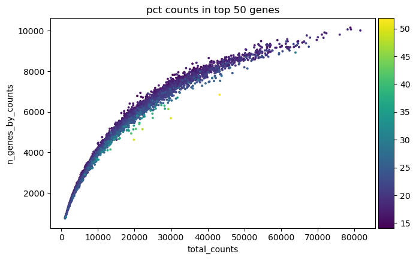


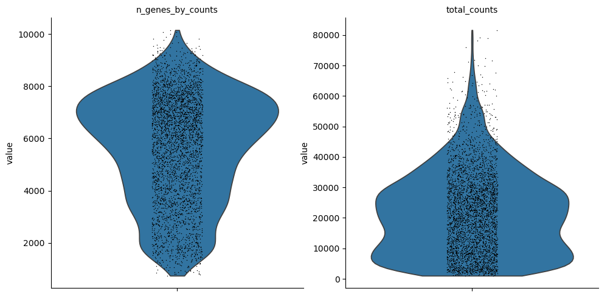


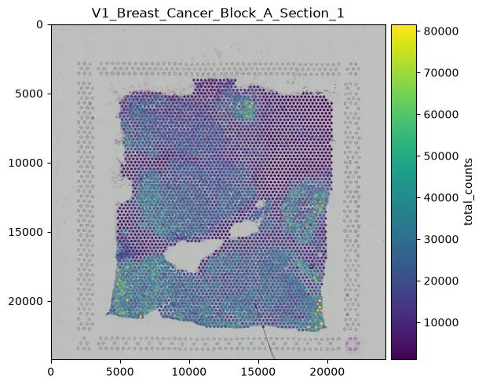

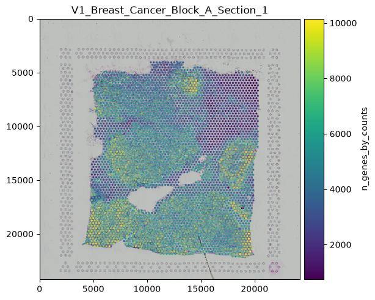

> <details-title>Optional: check QC summaries after filtering</hands-on-title>
>
> 1.  with the following parameters:
>    -  *"Annotated data matrix"*: `QC metrics after filtering`
>    - *"What to inspect?"*: `Key-indexed observations annotation (obs)`
>
> 2.  with the following parameters:
>    - Add an entry under *"Database Table"*.
>        -  *"Tabular Dataset for Table"*: the observations table from step 1
>        - In *"Table Options"*:
>            - *"Specify Name for Table"*: `obs`
>            - *"Use first line as column names"*: `Yes`
>    - *"SQL Query to generate tabular output"*: use the same SQL query as in **Optional: read the QC distributions as numbers**.
>    - *"include query result column headers"*: `Yes`
>        - *"Prefix character for column_header line"*: `#`
>
> Compare the spot count and the medians of `total_counts` and `n_genes_by_counts` with the pre-filter summary.
>
{: .details}

After filtering, **3,795 spots and 22,240 genes** remain. The median `total_counts` is **20,778**, and the median `n_genes_by_counts` is **6,029**. These values are close to the corresponding pre-filter medians of 20,761.5 and 6,026.5. The QC distributions remain broadly similar because only three spots were removed, while gene filtering reduced the number of rarely detected features.

# Normalisation and feature selection

Count depth differs between spots. `pp.normalize_total` rescales each spot so that its expression sums to the same target, and `pp.log1p` compresses the dynamic range. The validated main branch uses a target sum of **10,000 counts per spot**, which also produces the form of log-normalised expression expected later by CellTypist ().

> <hands-on-title>Normalise and log-transform the filtered expression matrix</hands-on-title>
>
> 1.  with the following parameters:
>    -  *"Annotated data matrix"*: `QC metrics after filtering`
>    - *"Method used for normalization"*: `Normalize counts per cell, using 'pp.normalize_total'`
>        - *"Target sum"*: `10000.0`
>        - *"Exclude (very) highly expressed genes for the computation of the normalization factor (size factor) for each cell"*: `No`
>
>
> 2.  with the following parameters:
>    -  *"Annotated data matrix"*: `The Normalised h5ad AnnData from the previous`  `step` 
>    - *"Method used for inspecting"*: `Logarithmize the data matrix, using 'pp.log1p'`
>
> Rename the generated file `Log-normalised AnnData`.
>
{: .hands_on}

Highly variable genes (HVGs) are genes whose between-spot variation is high relative to genes of similar abundance. They are useful for building an embedding around the most informative expression differences rather than letting thousands of nearly uniform genes contribute equal noise.

> <hands-on-title>Identify highly variable genes</hands-on-title>
>
> 1.  with the following parameters:
>    -  *"Annotated data matrix"*: `The Log-normalised AnnData h5ad from the previous`  `step` 
>    - *"Method used for filtering"*: `Annotate (and filter) highly variable genes, using 'pp.highly_variable_genes'`
>        - *"Choose the flavor for identifying highly variable genes"*: `Cell Ranger`
>            - *"Number of highly-variable genes to keep"*: `3000`
>        - *"Number of bins for binning the mean gene expression"*: `20`
>        - *"Inplace subset to highly-variable genes"*: `No`
>
> 2. Rename the generated file `AnnData with HVGs`.
>
> 3.  with the following parameters:
>    -  *"Annotated data matrix"*: `AnnData with HVGs`
>    - *"Method used for plotting"*: `Preprocessing: Plot dispersions versus means for genes, using 'pl.highly_variable_genes'`
>
>
{: .hands_on}

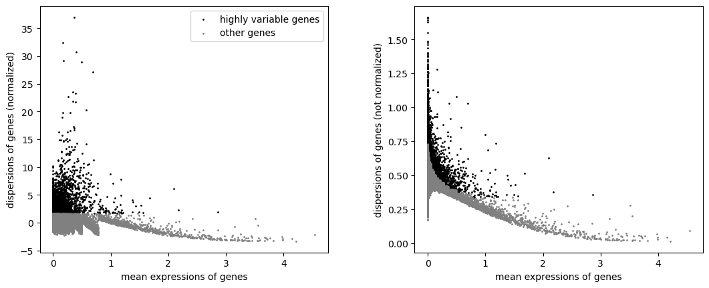

The object still contains **22,240 genes**; exactly **3,000** are marked as highly variable. `Inplace subset to highly-variable genes = No` is important here: PCA can use the HVG flag without deleting the other genes, so ranked-gene analysis, CellTypist and LIANA still have access to the wider log-normalised expression matrix.

> <question-title>Feature selection is not feature deletion</question-title>
>
> If the object still contains 22,240 genes, what does "3,000 HVGs" mean, and why is that distinction important later?
>
> > <solution-title></solution-title>
> >
> > The 3,000 genes are flagged as highly variable and are the informative feature set used by PCA; the remaining genes stay in the object because subsetting is disabled. A gene does not have to drive PCA to be biologically useful as a marker, reference feature or ligand/receptor partner.
> >
> {: .solution}
>
{: .question}

# Dimensionality reduction and clustering

{PCA} compresses correlated expression patterns into a smaller set of orthogonal components, and Scanpy reads the `highly_variable` flag set in the previous step so the decomposition is driven by the informative genes (). Fifty components are computed here.

The graph built from those components connects spots whose expression profiles are similar, not spots that sit near each other in the section. Scanpy calls this the **expression-neighbour graph** (), Leiden partitions it (), and {UMAP} gives a two-dimensional view of it. Keeping that straight matters for every result that follows: two spots on opposite edges of the tissue can be neighbours in this graph, and a group that looks compact on {UMAP} has not thereby been shown to occupy one region of the slide. Squidpy builds a second, genuinely spatial graph later in this tutorial from the Visium coordinates.

> <hands-on-title>Run the main PCA</hands-on-title>
>
> 1.  with the following parameters:
>    -  *"Annotated data matrix"*: `AnnData with HVGs`
>    - *"Method used"*: `Computes PCA (principal component analysis) coordinates, loadings and variance decomposition, using 'pp.pca'`
>        - *"Number of principal components to compute"*: `50`
>        - *"Change to use different initial states for the optimization"*: `0`
>        - *"Zero center"*: `Yes`
>        - *"Data type of the output"*: `float32`
>
> 2. Rename the generated file `AnnData with PCA`.
>
> 3.  with the following parameters:
>    -  *"Annotated data matrix"*: `AnnData with PCA`
>    - *"Method used for plotting"*: `PCA: Scatter plot in PCA coordinates, using 'pl.pca'`
>        - *"Keys for annotations of observations/cells or variables/genes"*: `log1p_total_counts,log1p_n_genes_by_counts,total_counts`
>
>
{: .hands_on}

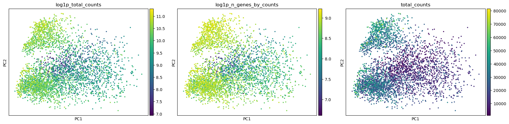

In this section, `total_counts` correlates with PC1 at approximately **−0.479**, PC2 at **+0.262** and PC3 at **−0.352**. Sequencing depth is therefore associated with variation along several principal components, but these correlations do not establish whether that variation is technical or biological. Differences in cell density, tissue composition and transcriptional activity can also contribute to count-depth variation across a tissue section.

> <details-title>Optional: regress total counts and compare the PCA</details-title>
>
> 1.  with the following parameters:
>    -  *"Annotated data matrix"*: `AnnData with HVGs`
>    - *"Method used for plotting"*: `Regress out unwanted sources of variation, using 'pp.regress_out'`
>        - *"Keys for observation annotation on which to regress on"*: `total_counts`
>
>
> 2.  with the following parameters:
>    -  *"Annotated data matrix"*: `The regressed AnnData h5ad from the previous`  `step` 
>    - *"Method used"*: `Computes PCA (principal component analysis) coordinates, loadings and variance decomposition, using 'pp.pca'`
>        - *"Number of principal components to compute"*: `50`
>        - *"Change to use different initial states for the optimization"*: `0`
>        - *"Zero center"*: `Yes`
>        - *"Data type of the output"*: `float32`
>
> 3. Rename the generated file `PCA after regression AnnData`.
>
> 4.  with the following parameters:
>    -  *"Annotated data matrix"*: `PCA after regression AnnData`
>    - *"Method used for plotting"*: `PCA: Scatter plot in PCA coordinates, using 'pl.pca'`
>        - *"Keys for annotations of observations/cells or variables/genes"*: `log1p_total_counts,log1p_n_genes_by_counts,total_counts`
>
> 5. Rename the output `Plot PCA after regression`.
>
{: .details}

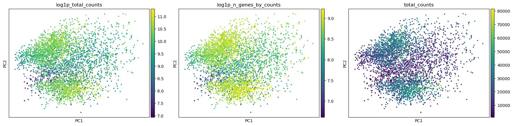

> <details-title>Optional: measure the association between total counts and PCA</hands-on-title>
>
> 1.  with the following parameters:
>    -  *"Annotated data matrix"*: `AnnData with PCA`
>    - *"What to inspect?"*: `Key-indexed observations annotation (obs)`
>
> 2.  with the following parameters:
>    -  *"Annotated data matrix"*: `AnnData with PCA`
>    - *"What to inspect?"*: `Multi-dimensional observations annotation (obsm)`
>        - *"Which annotation to inspect for the observations?"*: `PCA coordinates (X_pca)`
>
> 3.  with the following parameters:
>    - Add an entry under *"Database Table"*.
>        -  *"Tabular Dataset for Table"*: the observations table from step 1
>        - In *"Table Options"*:
>            - *"Specify Name for Table"*: `obs`
>            - *"Use first line as column names"*: `Yes`
>    - Add an entry under *"Database Table"*.
>        -  *"Tabular Dataset for Table"*: the PCA coordinates from step 2
>        - In *"Table Options"*:
>            - *"Specify Name for Table"*: `pcs`
>            - *"Use first line as column names"*: `Yes`
>    - *"SQL Query to generate tabular output"*:
>
>       ```sql
>       SELECT * FROM (
>       WITH j AS (
>         SELECT CAST(o.total_counts AS REAL) AS counts,
>                CAST(p."0" AS REAL) AS pc1,
>                CAST(p."1" AS REAL) AS pc2,
>                CAST(p."2" AS REAL) AS pc3
>         FROM obs AS o JOIN pcs AS p ON o.rowid = p.rowid
>       ),
>       centered AS (
>         SELECT *,
>                AVG(counts) OVER () AS m_counts,
>                AVG(pc1) OVER () AS m_pc1,
>                AVG(pc2) OVER () AS m_pc2,
>                AVG(pc3) OVER () AS m_pc3
>         FROM j
>       )
>       SELECT COUNT(*) AS spots,
>              SUM((counts-m_counts)*(pc1-m_pc1)) / SQRT(SUM((counts-m_counts)*(counts-m_counts))*SUM((pc1-m_pc1)*(pc1-m_pc1))) AS total_counts_vs_pc1,
>              SUM((counts-m_counts)*(pc2-m_pc2)) / SQRT(SUM((counts-m_counts)*(counts-m_counts))*SUM((pc2-m_pc2)*(pc2-m_pc2))) AS total_counts_vs_pc2,
>              SUM((counts-m_counts)*(pc3-m_pc3)) / SQRT(SUM((counts-m_counts)*(counts-m_counts))*SUM((pc3-m_pc3)*(pc3-m_pc3))) AS total_counts_vs_pc3
>       FROM centered
>       ) AS evidence_results;
>       ```
>
>    - *"include query result column headers"*: `Yes`
>        - *"Prefix character for column_header line"*: `#`
>
>    The query joins the tables by row position and calculates the Pearson correlation of `total_counts` with each of the first three components. Use the exports in their original row order.
>
> 4. If you ran the regression comparison, repeat step 2 using `PCA after regression AnnData`. Repeat step 3 with the new PCA coordinates as `pcs` and the observations table from step 1 as `obs`. Compare the three correlations before and after regression.
>
{: .details}

After regression the association between `total_counts` and the early components is effectively zero. That shows the operation did what it was asked to do. It does **not** show that the residualised matrix is the better one to analyse.

> <comment-title>What "removing biological signal" means here</comment-title>
>
> Total counts at a spot rise for two different reasons, and `regress_out` cannot distinguish them.
>
> The **technical** reason is capture efficiency. Permeabilisation, section thickness and local tissue integrity all vary across a slide, and a spot that released its mRNA less efficiently reports fewer counts for the same underlying biology. Variation of this kind is noise and is worth removing.
>
> The **biological** reason is that spots genuinely differ in what they contain. A 55 µm spot over densely packed tumour epithelium holds more cells, and more transcriptionally active ones, than a spot over loose collagen-rich stroma or adipose tissue. Its higher count is a real measurement of the tissue.
>
> `regress_out(total_counts)` removes the fitted linear association between each gene's expression and total counts. If total counts vary with tissue composition, the adjustment can also reduce biological variation. Here the regression serves as a sensitivity check for PCA, and the non-regressed matrix is used for downstream analysis.
>
{: .comment}

> <question-title>Which branch should continue?</question-title>
>
> 1. Why is the post-regression PCA useful even though it is not used for the main clustering branch?
> 2. Why would sending the residualised `.X` to CellTypist be a category error?
>
> > <solution-title></solution-title>
> >
> > 1. It is a diagnostic comparison: it shows how strongly the early components change when the total-count association is removed. That helps you judge whether depth is influencing the embedding without automatically deciding that every depth-associated component is technical.
> > 2. CellTypist expects log1p-normalised expression scaled to 10,000 counts per observation (). `regress_out` replaces `.X` with residuals that include negative values, so the matrix no longer carries that interpretation and the model would be reading values it was never trained on. CellTypist and the expression-neighbour graph both stay on the non-regressed branch for this reason.
> >
> {: .solution}
>
{: .question}

## The expression-neighbour graph and UMAP

Two steps follow from the {PCA}. `pp.neighbors` builds the expression-neighbour graph by connecting each spot to its 15 nearest neighbours in {PCA} space, and `tl.umap` embeds that graph in two dimensions for inspection (). Both run on `AnnData with PCA`, the non-regressed branch.

Colouring the embedding by the quality-control covariates is the check worth making at this point: if the count-depth gradient dominated the layout entirely, the groups found in the next section would be separating spots by how much signal they carry rather than by what they express.

> <hands-on-title>Compute the neighbourhood graph and UMAP</hands-on-title>
>
> 1.  with the following parameters:
>    -  *"Annotated data matrix"*: `AnnData with PCA`
>    - *"Method used for inspecting"*: `Compute a neighborhood graph of observations, using 'pp.neighbors'`
>        - *"The size of local neighborhood (in terms of number of neighboring data points) used for manifold approximation"*: `15`
>        - *"Use a hard threshold to restrict the number of neighbors to n_neighbors?"*: `Yes`
>        - *"Method for computing connectivities"*: `umap (McInnes et al, 2018)`
>        - *"Distance metric"*: `euclidean`
>        - *"Numpy random seed"*: `0`
>
>
> 2.  with the following parameters:
>    -  *"Annotated data matrix"*: `The AnnData h5ad from the previous`  `step` 
>    - *"Method used"*: `Embed the neighborhood graph using UMAP, using 'tl.umap'`
>        - *"Minimum distance"*: `0.5`
>        - *"Spread"*: `1.0`
>        - *"Random state"*: `0`
>
>  Rename the generated file `AnnData with UMAP`.
>
> 3.  with the following parameters:
>    -  *"Annotated data matrix"*: `AnnData with UMAP`
>    - *"Method used for plotting"*: `Embeddings: Scatter plot in UMAP basis, using 'pl.umap'`
>        - *"Keys for annotations of observations/cells or variables/genes"*: `log1p_total_counts,log1p_n_genes_by_counts,total_counts`
>
>
{: .hands_on}

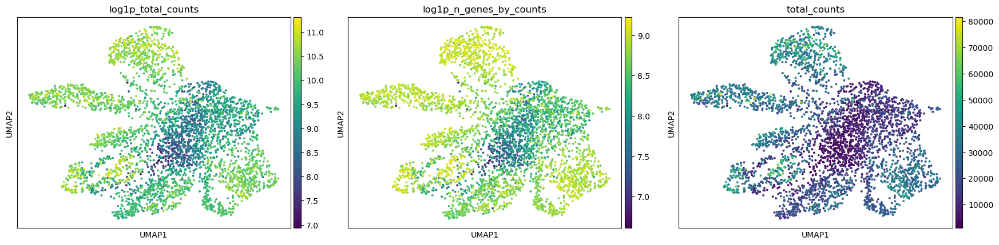


## Clustering at three resolutions

Leiden clustering partitions a graph into communities (). The resolution controls how readily larger communities are subdivided. No single resolution is intrinsically correct: the useful question is whether an extra split produces stable and interpretable expression programmes or merely fragments an already coherent group.

The learner-facing comparison is deliberately limited to **0.4, 0.8 and 1.2**.

> <hands-on-title>Cluster the expression-neighbour graph</hands-on-title>
>
> 1.  with the following parameters:
>    -  *"Annotated data matrix"*: `AnnData with UMAP`
>    - *"Method used"*: `Cluster cells into subgroups, using 'tl.leiden'`
>        - *"Coarseness of the clustering"*: `0.4`
>        - *"Key under which to add the cluster labels"*: `leiden_res_0.4`
>        - *"Use weights from knn graph?"*: `Yes`
>        - *"How many iterations of the Leiden clustering algorithm to perform"*: `2`
>        - *"Random state"*: `0`
>
>
> 2.  with the following parameters:
>    -  *"Annotated data matrix"*: `The AnnData from previous`  `step` 
>    - *"Method used"*: `Cluster cells into subgroups, using 'tl.leiden'`
>        - *"Coarseness of the clustering"*: `0.8`
>        - *"Key under which to add the cluster labels"*: `leiden_res_0.8`
>        - *"Use weights from knn graph?"*: `Yes`
>        - *"How many iterations of the Leiden clustering algorithm to perform"*: `2`
>        - *"Random state"*: `0`
>
> 3.  with the following parameters:
>    -  *"Annotated data matrix"*: `The AnnData from previous`  `step` 
>    - *"Method used"*: `Cluster cells into subgroups, using 'tl.leiden'`
>        - *"Coarseness of the clustering"*: `1.2`
>        - *"Key under which to add the cluster labels"*: `leiden_res_1.2`
>        - *"Use weights from knn graph?"*: `Yes`
>        - *"How many iterations of the Leiden clustering algorithm to perform"*: `2`
>        - *"Random state"*: `0`
>
>  Rename the generated file `AnnData with Leiden comparison 0.4 and 0.8 and 1.2`.
>
> 4.  with the following parameters:
>    -  *"Annotated data matrix"*: `AnnData with Leiden comparison 0.4 and 0.8 and 1.2`
>    - *"Method used for plotting"*: `Embeddings: Scatter plot in UMAP basis, using 'pl.umap'`
>        - *"Keys for annotations of observations/cells or variables/genes"*: `leiden_res_0.4,leiden_res_0.8,leiden_res_1.2`
>
>
{: .hands_on}

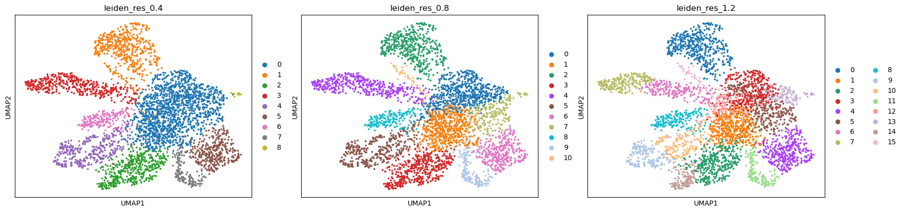

> <details-title>Optional: compare Leiden group membership across resolutions</hands-on-title>
>
> 1.  with the following parameters:
>    -  *"Annotated data matrix"*: `AnnData with Leiden comparison 0.4 and 0.8 and 1.2`
>    - *"What to inspect?"*: `Key-indexed observations annotation (obs)`
>
> 2.  with the following parameters:
>    - Add an entry under *"Database Table"*.
>        -  *"Tabular Dataset for Table"*: the observations table from step 1
>        - In *"Table Options"*:
>            - *"Specify Name for Table"*: `obs`
>            - *"Use first line as column names"*: `Yes`
>    - *"SQL Query to generate tabular output"*: run one query per job using the four queries below.
>    - *"include query result column headers"*: `Yes`
>        - *"Prefix character for column_header line"*: `#`
>
>    **Group sizes at the three resolutions**
>
>    ```sql
>    SELECT * FROM (
>    WITH sizes AS (
>     SELECT '0.4' AS resolution, CAST("leiden_res_0.4" AS TEXT) AS leiden_group, COUNT(*) AS spots FROM obs GROUP BY "leiden_res_0.4"
>     UNION ALL
>     SELECT '0.8', CAST("leiden_res_0.8" AS TEXT), COUNT(*) FROM obs GROUP BY "leiden_res_0.8"
>     UNION ALL
>     SELECT '1.2', CAST("leiden_res_1.2" AS TEXT), COUNT(*) FROM obs GROUP BY "leiden_res_1.2"
>    )
>    SELECT resolution, leiden_group, spots,
>     ROUND(100.0*spots/(SELECT COUNT(*) FROM obs),2) AS pct_spots
>    FROM sizes ORDER BY CAST(resolution AS REAL), CAST(leiden_group AS INTEGER)
>    ) AS evidence_results;
>    ```
>
>    **Adjusted Rand index between successive resolutions**
>
>    ```sql
>    SELECT * FROM (
>    WITH labels AS (
>     SELECT '0.4_vs_0.8' AS comparison,
>            CAST("leiden_res_0.4" AS TEXT) AS a,
>            CAST("leiden_res_0.8" AS TEXT) AS b FROM obs
>     UNION ALL
>     SELECT '0.8_vs_1.2', CAST("leiden_res_0.8" AS TEXT),CAST("leiden_res_1.2" AS TEXT) FROM obs
>    ),
>     pair_counts AS (SELECT comparison,a,b,COUNT(*) AS nij FROM labels GROUP BY comparison,a,b),
>     a_counts AS (SELECT comparison,a,SUM(nij) AS ni FROM pair_counts GROUP BY comparison,a),
>     b_counts AS (SELECT comparison,b,SUM(nij) AS nj FROM pair_counts GROUP BY comparison,b),
>     term_joint AS (SELECT comparison,SUM(1.0*nij*(nij-1)/2.0) AS same_pairs FROM pair_counts GROUP BY comparison),
>     term_a AS (SELECT comparison,SUM(1.0*ni*(ni-1)/2.0) AS row_pairs,SUM(ni) AS n FROM a_counts GROUP BY comparison),
>     term_b AS (SELECT comparison,SUM(1.0*nj*(nj-1)/2.0) AS col_pairs FROM b_counts GROUP BY comparison),
>     terms AS (SELECT j.comparison,a.n,j.same_pairs,a.row_pairs,b.col_pairs,
>      (a.row_pairs*b.col_pairs)/(1.0*a.n*(a.n-1)/2.0) AS expected_pairs
>     FROM term_joint j JOIN term_a a USING(comparison) JOIN term_b b USING(comparison))
>    SELECT comparison,n AS spots,
>     (same_pairs-expected_pairs) / (0.5*(row_pairs+col_pairs)-expected_pairs) AS adjusted_rand_index
>    FROM terms ORDER BY comparison
>    ) AS evidence_results;
>    ```
>
>    **Spot counts by group at resolutions 0.4 and 0.8**
>
>    ```sql
>    SELECT CAST("leiden_res_0.4" AS TEXT) AS group_0_4,
>     CAST("leiden_res_0.8" AS TEXT) AS group_0_8,
>     COUNT(*) AS spots
>    FROM obs
>    GROUP BY "leiden_res_0.4", "leiden_res_0.8"
>    ORDER BY CAST("leiden_res_0.4" AS INTEGER), spots DESC;
>    ```
>
>    **Spot counts by group at resolutions 0.8 and 1.2**
>
>    ```sql
>    SELECT CAST("leiden_res_0.8" AS TEXT) AS group_0_8,
>           CAST("leiden_res_1.2" AS TEXT) AS group_1_2,
>           COUNT(*) AS spots
>    FROM obs
>    GROUP BY "leiden_res_0.8", "leiden_res_1.2"
>    ORDER BY CAST("leiden_res_0.8" AS INTEGER), spots DESC;
>    ```
>
> Use the group-size output to compare the partitions. The adjusted Rand index summarises agreement after accounting for chance. The two group-membership tables show which spots were assigned together at one resolution and split across groups at the next.
>
{: .details}

| Resolution | Number of groups | Largest group | Interpretation |
| ---: | ---: | ---: | --- |
| 0.4 | 9 | 1,390 spots | Coarser expression-based partition |
| 0.8 | 11 | 609 spots | Intermediate partition used for subsequent analyses |
| 1.2 | 16 | 448 spots | Finer expression-based partition |

The three resolutions produce different partitions of the same expression-neighbour graph. The adjusted Rand index is **0.654** between resolutions 0.4 and 0.8 and **0.704** between 0.8 and 1.2, indicating that changing the resolution changes group membership.

At resolution 0.4, group `0` contains 1,390 spots. Of these, 608 are assigned to group `0`, 556 to group `1` and 194 to group `7` at resolution 0.8, with smaller numbers distributed among other groups. Their marker profiles differ: group `0` is enriched for stromal and extracellular-matrix-associated genes, group `1` for immunoglobulin transcripts, and group `7` for antigen-presentation and myeloid-associated genes.

Resolution 0.8 is retained as an intermediate level of detail for investigating these expression programmes and their spatial distribution. Neither the number of groups nor their separation on UMAP is sufficient to establish distinct cell types.

> <question-title>Choose a resolution from evidence</question-title>
>
> Which argument best supports carrying `leiden_res_0.8` forward?
>
> A. It produces a fixed number of biologically distinct cell types.
>
> B. It provides an intermediate partition in which the large group at resolution 0.4 separates into groups with distinguishable marker-gene programmes, allowing their spatial organisation to be examined.
>
> C. Its UMAP panel appears more clearly separated than the other resolutions.
>
> > <solution-title></solution-title>
> >
> > **B.** Resolution 0.8 distinguishes an extracellular-matrix-associated programme, an immunoglobulin-rich programme and an antigen-presentation-associated programme that were largely combined in one group at resolution 0.4. The adjusted Rand index shows that changing resolution alters group membership, while the marker evidence helps interpret the resulting partitions. Neither UMAP appearance nor group count alone establishes biological validity.
> >
> {: .solution}
>
{: .question}

# Marker genes

`tl.rank_genes_groups` tests each group against the union of all the others and returns the genes most strongly enriched in it (). The Wilcoxon rank-sum test is used here because it makes no assumption about the shape of the expression distribution, and Benjamini-Hochberg correction is applied across the genes tested.

This is the step where a numbered group starts to mean something biological. How far that meaning can be pushed depends on what a group is: 55 µm of tissue holding several cells, so a ranked gene list describes the programme that dominates a domain rather than the contents of a cell.

> <hands-on-title>Rank genes for the selected partition</hands-on-title>
>
> 1.  with the following parameters:
>    -  *"Annotated data matrix"*: `AnnData with Leiden comparison 0.4 and 0.8 and 1.2`
>    - *"Method used for inspecting"*: `Rank genes for characterizing groups, using 'tl.rank_genes_groups'`
>        - *"Get ranked genes as a Tabular file?"*: `True`
>        - *"The key of the observations grouping to consider"*: `leiden_res_0.8`
>        - *"Use 'raw' attribute of input if present"*: `No`
>        - *"Comparison"*: `Compare each group to the union of the rest of the group`
>        - *"Method"*: `Wilcoxon-Rank-Sum`
>            - *"Correction method"*: `Benjamini-Hochberg`
>            - *"Use tie correction for 'wilcoxon' scores"*: `No`
>
> 2. Rename the AnnData output `AnnData with markers` and the table output `Rank genes for characterizing groups`.
>
> 3.  with the following parameters:
>    -  *"Annotated data matrix"*: `AnnData with markers`
>    - *"Method used for plotting"*: `Marker genes: Plot ranking of genes, using 'pl.rank_genes_groups'`
>        - *"Number of genes to show"*: `20`
>        - *"Font size"*: `8`
>        - *"Number of panels per row"*: `4`
>        - *"Share the y-axis across panels"*: `Yes`
>
>
{: .hands_on}

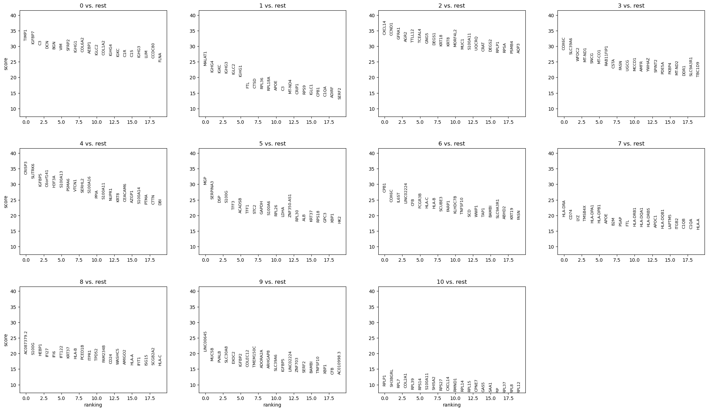


## Annotating the groups

The single-cell and spatial atlas of human breast cancers defines the epithelial, mesenchymal and immune lineages of this tumour type and their marker genes (), and the adult human breast atlas gives the normal-tissue counterpart (). Integrated single-cell and spatial studies of breast tumours use the same marker vocabulary in a spatial setting (). Matching the ranked genes against those references is what turns a group number into a description.

| Group | Spots | Examples among high-ranked genes | Expression programme suggested by the markers | Biological basis |
| --- | ---: | --- | --- | --- |
| `0` | 609 | *TIMP1*, *IGFBP7*, *C3*, *DCN*, *BGN*, *SFRP2*, *IGHG1* | Fibroblast- and extracellular-matrix-associated stromal programme with immunoglobulin signal | *DCN*, *BGN* and *SFRP2* support a fibroblast-associated extracellular-matrix programme. *IGHG1* indicates an additional immunoglobulin-associated contribution, consistent with mixed cellular RNA in Visium spots (, ). |
| `1` | 578 | *IGHG4*, *IGKC*, *IGHG3*, *IGLC2*, *IGHG1* | Immunoglobulin-rich programme compatible with antibody-producing cell contributions | Immunoglobulin heavy- and light-chain transcripts are characteristic of antibody-producing B-lineage cells, particularly plasma cells. Their enrichment does not establish that each spot consists exclusively of plasma cells (). |
| `2` | 451 | *CXCL14*, *CCND1*, *GFRA1*, *AGR2*, *KRT18*, *KRT8*, *MUC1* | Luminal epithelial-associated programme | *KRT8*, *KRT18* and *MUC1* support luminal epithelial expression, while *AGR2* and *CCND1* are compatible with epithelial secretory and proliferative programmes. These markers alone do not establish malignant identity (, ). |
| `3` | 436 | *COX6C*, *SLC39A6*, *WFDC2*, *SNCG*, *FASN* | Epithelial-associated programme with metabolic and secretory features | *SLC39A6* and *WFDC2* are associated with epithelial expression, while *FASN* and *COX6C* reflect lipid-metabolic and mitochondrial functions. The combination distinguishes this group without establishing a specific tumour subtype (). |
| `4` | 425 | *CRISP3*, *SLITRK6*, *IGFBP5*, *VTCN1*, *KRT8* | CRISP3-high epithelial-associated programme | *CRISP3* is strongly enriched in this group, alongside genes associated with epithelial expression and regulation. Its spatially concentrated expression provides additional evidence for a distinct expression-associated tissue region, but not a definitive cell type (). |
| `5` | 359 | *MGP*, *SERPINA3*, *DSP*, *S100G*, *TFF3*, *TFF1* | TFF-associated epithelial programme with additional mixed expression signals | *TFF1* and *TFF3* support a secretory or hormone-responsive epithelial-associated programme. Other enriched genes indicate that the group should not be assigned a single epithelial subtype solely from its marker ranking (, ). |
| `6` | 335 | *CPB1*, *IL6ST*, *CFB*, *HLA-B*, *HLA-C*, *TAP1* | CPB1-high programme with antigen-processing-associated expression | *CPB1* distinguishes this expression programme, while *HLA-B*, *HLA-C* and *TAP1* participate in MHC class I antigen presentation. These features do not independently establish the lineage of the contributing cells (, ). |
| `7` | 214 | *HLA-DRA*, *CD74*, *LYZ*, *HLA-DPA1*, *APOE*, *C1QA* | Antigen-presentation and myeloid-associated programme | *HLA-DRA*, *HLA-DPA1* and *CD74* support MHC class II antigen presentation, while *LYZ*, *APOE* and *C1QA* are compatible with myeloid-associated expression. These markers suggest immune contributions without proving an exclusive macrophage identity (). |
| `8` | 186 | *S100G*, *HEBP1*, *IFI27*, *IFI6*, *HLA-B* | Interferon-associated programme; precise cellular origin uncertain | *IFI27* and *IFI6* are interferon-responsive genes. Their enrichment supports an interferon-associated expression state, but the marker combination is insufficient to assign a specific breast cell lineage (). |
| `9` | 161 | *MUC5B*, *PVALB*, *SLC30A8*, *IGFBP2* | Distinct expression programme of uncertain cellular origin | The leading genes do not provide a sufficiently specific and consistent lineage signature for a confident annotation. The group is therefore retained as an expression-defined domain requiring further characterisation. |
| `10` | 41 | *RPLP1*, *RPL7*, *COL2A1*, *RPL39*, *RPS14* | Ribosomal-protein-enriched programme; biological identity unresolved | Several leading genes encode ribosomal proteins, indicating a distinctive expression programme. Ribosomal enrichment alone does not establish poor data quality: the group's median total counts and detected-gene complexity are comparable to those of the overall section. |

Several Leiden groups show related epithelial-associated programmes. Groups `2`, `3`, `4`, `5` and `6` differ in their highest-ranked genes, including combinations of keratins, secretory-associated genes and antigen-processing genes. Their separation reflects differences in expression profiles, but does not establish distinct malignant subtypes or histological compartments.

Groups `0` and `1` illustrate the mixed nature of Visium measurements. Group `0` combines extracellular-matrix-associated genes with immunoglobulin transcripts, whereas group `1` is particularly enriched for immunoglobulin heavy- and light-chain genes. The rankings are consistent with different contributions from stromal and antibody-producing cell populations, but cannot determine their proportions within individual spots.

Group `7` is characterised by `HLA-DRA`, `CD74`, `LYZ` and other antigen-presentation-associated genes. This supports a myeloid-associated expression programme, although the ranking alone cannot identify all contributing cells or establish a distinct lymphoid structure.

Some groups remain incompletely characterised. Group `9` lacks a sufficiently specific combination of established breast-lineage markers, while group `10` is enriched for ribosomal-protein genes. Group `10` has a median of 6,115 detected genes and 21,682 total counts, so its marker pattern does not by itself indicate poor library complexity. Additional evidence is needed before assigning either group a more specific biological identity.


> <comment-title>Why marker-based annotation is weaker on Visium than on single cells</comment-title>
>
> In a segmented single-cell experiment, a group whose cells all express *COL1A1* and *DCN* can reasonably be called fibroblasts. On Visium, the same ranking means that spots in that group contain more fibroblast RNA than other spots do. The spot may still contain epithelium, vessels and immune cells alongside the fibroblasts, and that mixture is why group `0` also shows immunoglobulin signal.
>
> Recovering actual proportions requires deconvolution against a matched single-cell reference (, ). Without that step, the defensible statement is about which programme dominates a domain, not about which cells are present.
>
{: .comment}

> <question-title>Interpret marker genes in multicellular spots</question-title>
>
> 1. Group `0` is enriched for extracellular-matrix-associated genes and immunoglobulin transcripts. Why is it inappropriate to assign every spot in this group a single fibroblast identity?
> 2. Group `10` is enriched for ribosomal-protein genes. What additional evidence should be considered before describing it as a low-quality group?
>
> > <solution-title></solution-title>
> >
> > 1. A Visium spot can contain RNA from fibroblasts, immune cells, epithelial cells and other populations. Enrichment of fibroblast-associated markers indicates a contribution from that expression programme, not exclusive fibroblast identity.
> >
> > 2. Ribosomal enrichment should be considered alongside the number of detected genes, total counts, spatial location and other marker genes. Group `10` has count and detected-gene medians comparable to the overall section, so low complexity is not established by these data.
> >
> {: .solution}
>
{: .question}

# Spatial statistics with Squidpy

Up to this point, neighbourhood meant **expression similarity**. Squidpy now constructs a separate graph from the Visium coordinates ().

The settings follow from how the slide is printed. Capture spots sit at fixed positions in a hexagonal lattice, so every interior spot has exactly six immediate neighbours a known distance away. Squidpy exposes this directly: `coord_type = grid` with `n_neighs = 6` and `n_rings = 1` connects each spot to the six that touch it ().

This is where a sequencing-based analysis diverges structurally from an imaging-based one. Segmented cells occupy irregular positions with no lattice to exploit, so their graph has to be built with `coord_type = generic`, using Delaunay triangulation or a distance cut-off. Using the generic setting on Visium data would discard geometry the slide design already guarantees.

> <comment-title>What `n_rings` controls</comment-title>
>
> Increasing `n_rings` extends the graph outwards by whole rings of the lattice: two rings connect each spot to its six immediate neighbours plus the twelve beyond them. A wider graph smooths the statistics that follow, which can help when domains are large and diffuse, but it also blurs boundaries between adjacent domains. One ring keeps the analysis at the finest spatial scale Visium can support.
>
{: .comment}

> <hands-on-title>Build the Visium spatial-neighbour graph</hands-on-title>
>
> 1.  with the following parameters:
>    -  *"spatial object (in SpatialData or AnnData format)"*: `AnnData with markers`
>    - *"Operation"*: `Create a graph from spatial coordinates (gr.spatial_neighbors)`
>        - *"Spatial key"*: `spatial`
>        - *"Coordinate type"*: `grid`
>        - *"Number of neighbors"*: `6`
>        - *"Number of rings"*: `1`
>        - *"Delaunay triangulation"*: `No`
>        - *"Set diagonal"*: `No`
>        - *"Key added"*: `spatial`
>
>
{: .hands_on}

The resulting `spatial_connectivities` matrix describes physical adjacency on the capture grid. It does not replace the Scanpy graph used for UMAP and Leiden; both graphs remain in the object for different analyses.

## Spatial centrality measures

Squidpy calculates centrality for each Leiden group on the spatial graph. Degree centrality is the fraction of spots outside the group that share an edge with at least one group member. Closeness centrality describes how close the group is to the other spots along paths in the graph ().

> <hands-on-title>Calculate group-level spatial statistics</hands-on-title>
>
> 1.  with the following parameters:
>    -  *"spatial object (in SpatialData or AnnData format)"*: `AnnData with spatial neighbours from the previous  `step` 
>    - *"Operation"*: `Compute centrality scores per cluster or cell type (gr.centrality_scores)`
>        - *"Key in adata.obs where clustering is stored"*: `leiden_res_0.8`
>        - *"Connectivity key"*: `spatial_connectivities`
>
>
> 2.  with the following parameters:
>    -  *"spatial object (in SpatialData or AnnData format)"*: `AnnData with centrality scores from previous`  `step`
>    - *"Operation"*: `Plot centrality scores (pl.centrality_scores)`
>        - *"Key in adata.obs where clustering is stored"*: `leiden_res_0.8`
>
>
> 3.  with the following parameters:
>    -  *"spatial object (in SpatialData or AnnData format)"*: `AnnData with centrality scores from previous`  `step`
>    - *"Operation"*: `Compute neighborhood enrichment by permutation test (gr.nhood_enrichment)`
>        - *"Key in adata.obs where clustering is stored"*: `leiden_res_0.8`
>        - *"Connectivity key"*: `spatial_connectivities`
>        - *"Number of permutations"*: `1000`
>
>
> 4.  with the following parameters:
>    -  *"spatial object (in SpatialData or AnnData format)"*: `AnnData with neighborhood enrichment from previous`  `step` 
>    - *"Operation"*: `Plot neighborhood enrichment (pl.nhood_enrichment)`
>        - *"Key in adata.obs where clustering is stored"*: `leiden_res_0.8`
>        - *"Mode"*: `zscore`
>        - *"Annotate cells"*: `No`
>        - *"Color map"*: `viridis`
>
>
{: .hands_on}

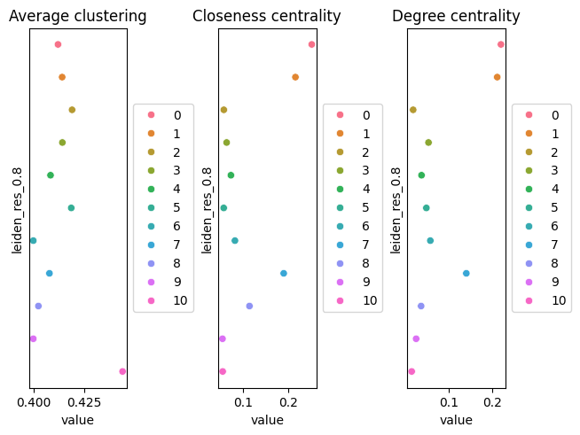

Group `0` has the highest degree centrality (**0.220**) and closeness centrality (**0.253**). Group `1` also has relatively high values (**0.212** and **0.216**), while group `7` has degree centrality of **0.140** and closeness centrality of **0.190**. These scores reflect how each expression-defined group is positioned within the spatial-neighbour graph. They describe the organisation of the groups across the section, not their biological importance or signalling activity.

## Neighbourhood enrichment

Neighbourhood enrichment asks whether two group labels sit next to each other in the spatial graph more or less often than chance allows. Squidpy counts the observed adjacencies, shuffles the group labels across spots many times, and reports how far the observed count sits from the permuted distribution as a z-score (). A positive value means the two labels are neighbours more often than expected, a negative value less often.

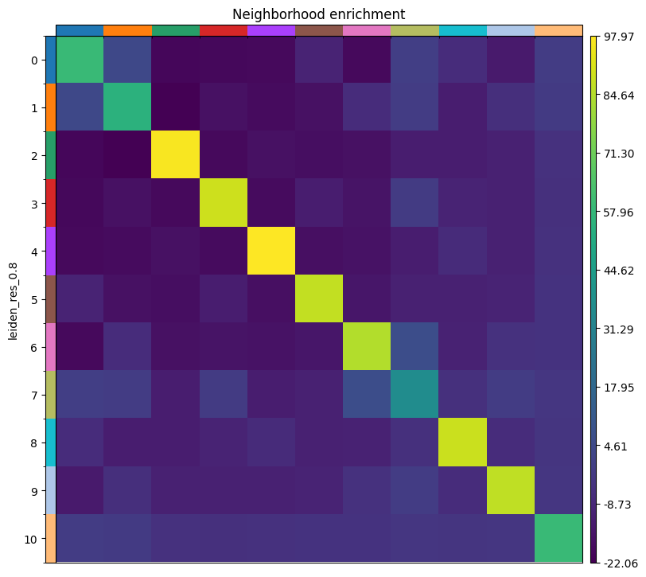

The diagonal values show strong within-group spatial enrichment. For example, group `4` has a diagonal z-score of approximately **+97.97**, while group `7` has a diagonal z-score of approximately **+36.23**. These positive values indicate that spots assigned to the same Leiden group occur next to one another more frequently than expected under random reassignment of the group labels.

Off the diagonal, groups `6`–`7` show positive enrichment (**z ≈ +6.31**), as do groups `0`–`1` (**z ≈ +3.79**). The value for `0`–`7` is much smaller (**z ≈ +0.29**) and should not be interpreted as strong enrichment. In contrast, adjacency between groups `1`–`2` (**z ≈ −22.06**) and `0`–`2` (**z ≈ −19.99**) is strongly depleted. These results describe the physical arrangement of expression-defined groups across the Visium grid. Positive enrichment supports non-random adjacency between group labels; it does not establish direct molecular communication or signalling direction.

> <question-title>Adjacency is not communication</question-title>
>
> Groups `6` and `7` are adjacent more often than expected. Which statement is justified?
>
> A. Group `6` sends a signal to group `7`.
>
> B. Spots carrying labels `6` and `7` share edges in the Visium spatial graph more often than expected under the permutation null.
>
> > <solution-title></solution-title>
> >
> > **B.** The enrichment analysis works on group labels and physical adjacency. It contains no ligand-receptor model and establishes neither molecular interaction nor causal direction.
> >
> {: .solution}
>
{: .question}

## Spatially variable genes

Moran's I asks whether expression values for a gene are spatially autocorrelated over the graph: a high positive value means similar expression tends to occur in neighbouring spots. It is a statement about pattern, not mechanism.

> <hands-on-title>Calculate Moran's I</hands-on-title>
>
> 1.  with the following parameters:
>    -  *"spatial object (in SpatialData or AnnData format)"*: `AnnData with neighborhood enrichment from previous`  `step`
>    - *"Operation"*: `Calculate Global Autocorrelation Statistic (Moran’s I or Geary's C) (gr.spatial_autocorr)`
>        - *"Connectivity key"*: `spatial_connectivities`
>        - *"Mode"*: `Moran's I`
>        - *"Attribute"*: `X`
>        - *"Transformation"*: `Yes`
>        - *"Number of permutations"*: `1000`
>        - *"Two tailed"*: `No`
>        - *"Use raw counts"*: `No`
>
> Rename the generated file `AnnData with Moran's I`.
>
{: .hands_on}

The ten highest-ranked genes in the reference run are shown below.

| Gene | Moran's I | Reading |
| --- | ---: | --- |
| *CRISP3* | 0.729 | Highest mean expression in group `4` |
| *CPB1* | 0.712 | Highest mean expression in group `6` |
| *IGHG3* | 0.706 | Spatially structured immunoglobulin signal |
| *IGLC2* | 0.702 | Spatially structured immunoglobulin signal |
| *ALB* | 0.668 | Spatially patterned expression |
| *IGHG1* | 0.638 | Spatially structured immunoglobulin signal |
| *CXCL14* | 0.620 | Spatially patterned chemokine expression |
| *SLITRK6* | 0.619 | Spatially patterned epithelial-associated expression |
| *S100G* | 0.616 | Spatially patterned expression |
| *C3* | 0.614 | Spatially structured complement signal |

Moran's I was calculated for the 3,000 highly variable genes. Three immunoglobulin genes appear in the top ten, indicating spatial structure in immunoglobulin-associated expression across this section.

### Visual confirmation on the tissue

A high Moran's I indicates that a gene is more spatially structured than random, but the statistic alone does not show what that structure looks like. Plotting a high-scoring gene back onto the section is therefore a necessary check: a gene that is genuinely spatially informative should resolve into a coherent territory or gradient rather than scattered speckle. The plot also helps separate a real biological pattern from an apparent one driven by a handful of very high-expressing spots.

To do this we import the AnnData table carrying the Squidpy results back into the SpatialData object, then colour the capture spots by expression of the gene of interest. The steps below use *CRISP3*, the highest-scoring gene in this section.

> <hands-on-title>Visualise a high-scoring gene on the tissue</hands-on-title>
>
> 1.  with the following parameters:
>    -  *"SpatialData object"*: `V1_Breast_Cancer_Block_A_Section_1.spatialdata.zip`
>    - *"Operation"*: `Import anndata table to a SpatialData object`
>        -  *"annotated data object to add"*: `AnnData with Moran's I`
>        - *"Table name"*: `table_processed`
>
>
> 2.  with the following parameters:
>    -  *"SpatialData object"*: the SpatialData output from step 1 ()
>    - In *"Render Images"*:
>        - *"Image element name"*: `V1_Breast_Cancer_Block_A_Section_1_hires_image`
>    - In *"Render Shapes"*:
>        - *"Shapes element name"*: `V1_Breast_Cancer_Block_A_Section_1`
>        - *"Color column"*: `CRISP3`
>        - *"Scale factor"*: `1.0`
>        - *"Table name"*: `table_processed`
>    - In *"Plot Display Parameters"*:
>        - *"Coordinate system(s)"*: `V1_Breast_Cancer_Block_A_Section_1`
>        - *"Legend location"*: `Right margin`
>        - *"Enable colorbars?"*: `Yes`
>        - *"Image format"*: `JPG`
>
>
{: .hands_on}

> <comment-title>Shapes, not labels</comment-title>
>
> Visium capture spots are stored in the SpatialData object as **shapes**, that is, circles of fixed radius positioned on the capture grid. They are not a segmentation mask, so there is no labels element to render. Use *"Render Shapes"* for any Visium overlay. In a Xenium analysis, where cells really are segmented, the equivalent overlay would use *"Render Labels"* instead.
>
{: .comment}

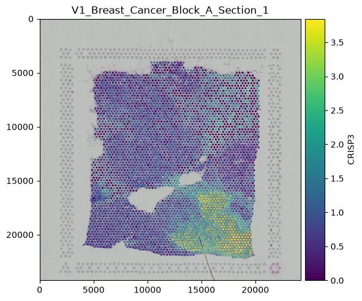

*CRISP3* was the top-ranked marker for Leiden group `4`, which had the highest mean expression of the gene. The map shows where high-expression spots occur across the tissue. The strongest signal is concentrated in the region occupied by group `4`, with lower expression also detected in other groups.

> <question-title>Read the statistic and the map together</question-title>
>
> 1. *CRISP3* and *C3* have Moran's I values of 0.729 and 0.614, respectively. What does the difference tell you, and what would you need to inspect on the tissue maps?
>
> 2. A gene returns a low Moran's I but is clearly a strong marker for one Leiden group in the ranked-gene table. Is that a contradiction?
>
> > <solution-title></solution-title>
> >
> > 1. *CRISP3* has stronger positive spatial autocorrelation on this graph. Compare the tissue maps to see where high expression occurs and how much of the section it covers
> > 2. No. The two statistics ask different questions. Ranked genes ask whether expression differs between groups of spots defined in expression space; Moran's I asks whether expression is arranged coherently in physical space. A marker for a group whose spots are scattered across several parts of the section can be highly discriminative and still have low spatial autocorrelation.
> >
> {: .solution}
>
{: .question}

> <question-title>What does a high Moran's I leave unanswered?</question-title>
>
> *CRISP3* has Moran's I ≈ 0.729. Which of the following still requires additional evidence: whether its expression is spatially patterned, why that pattern occurs, or whether the gene causes the neighbouring tissue state?
>
> > <solution-title></solution-title>
> >
> > The statistic supports the first statement: expression is spatially autocorrelated on this graph. The **cause** of the pattern and any **functional effect** remain unanswered. A spatial statistic does not provide a mechanism.
> >
> {: .solution}
>
{: .question}

# Cell type annotation with CellTypist

CellTypist was designed to compare query expression profiles with labelled single-cell references (). The model used here contains cell states from adult human breast tissue (); the full catalogue of available models is published by the CellTypist developers (). For this Visium analysis, the appropriate interpretation is therefore **reference-based label transfer**: each mixed spot is assigned the reference profile with the largest score, not proven to be one cell of that type.

The input is `AnnData with Moran's I`, which still carries the **non-regressed**, log1p-normalised expression matrix scaled to 10,000 counts per spot.

> <hands-on-title>Transfer adult-breast reference labels to the spots</hands-on-title>
>
> 1.  with the following parameters:
>    -  *"Input AnnData file"*: `AnnData with Moran's I`
>    - *"Select model from"*: `Cached`
>        - *"Choose CellTypist model"*: `cell types from the adult human breast (v1)`
>    - *"Annotation mode"*: `Choose the cell type with the largest score/probability as the final prediction`
>    - *"Refine the predicted labels by running the majority voting classifier after over-clustering"*: `No`
>    - *"Generate a dotplot of the predicted cell types"*: `Yes`
>        - *"Reference column in AnnData.obs for dotplot"*: `leiden_res_0.8`
>        - *"Prediction label in AnnData.obs for dotplot"*: `predicted_labels`
>
{: .hands_on}


> <details-title>Optional: check the CellTypist label counts and confidence</hands-on-title>
>
> The direct predictions can be summarised numerically to check how often each reference label is assigned and how those assignments vary between Leiden groups.
>
> 1.  with the following parameters:
>    -  *"Annotated data matrix"*: the annotated AnnData output from the previous  step
>    - *"What to inspect?"*: `Key-indexed observations annotation (obs)`
>
>    This exports the per-spot reference predictions, including `predicted_labels`, `conf_score` and `leiden_res_0.8`.
>
> 2.  with the following parameters:
>    - In *"Database Table"*:
>        -  *"Tabular Dataset for Table"*: the observation table from the previous  step
>        - In *"Table Options"*:
>            - *"Specify Name for Table"*: `obs`
>            - *"Use first line as column names"*: `Yes`
>    - *"SQL Query to generate tabular output"*:
>
>      ```sql
>      SELECT CAST(predicted_labels AS TEXT) AS predicted_label,
>             COUNT(*) AS spots,
>             ROUND(100.0 * COUNT(*) /
>                   (SELECT COUNT(*) FROM obs), 2) AS pct_spots
>      FROM obs
>      GROUP BY predicted_labels
>      ORDER BY spots DESC, predicted_label;
>      ```
>
>    - *"include query result column headers"*: `Yes`
>        - *"Prefix character for column_header line"*: `#`
>
>    This produces the reference-label counts and percentages for the table below.
>
> 3.  with the same input observation table and table name `obs`, using the following SQL query:
>
>    ```sql
>    SELECT * FROM (
>    WITH ranked AS (
>        SELECT CAST(conf_score AS REAL) AS confidence,
>               ROW_NUMBER() OVER (
>                   ORDER BY CAST(conf_score AS REAL)
>               ) AS rn,
>               COUNT(*) OVER () AS n
>        FROM obs
>        WHERE conf_score IS NOT NULL
>    )
>    SELECT COUNT(*) AS spots_with_confidence,
>           MIN(confidence) AS min_confidence,
>           (SELECT AVG(confidence)
>            FROM ranked
>            WHERE rn IN ((n+1)/2, (n+2)/2)
>           ) AS median_confidence,
>           MAX(confidence) AS max_confidence
>    FROM ranked
>    ) AS evidence_results;
>    ```
>
>    Set *"include query result column headers"* to `Yes` with prefix `#`.
>
> 4.  with the same input observation table and table name `obs`, using the following SQL query:
>
>    ```sql
>    SELECT CAST(o."leiden_res_0.8" AS TEXT) AS leiden_group,
>           CAST(o.predicted_labels AS TEXT) AS predicted_label,
>           COUNT(*) AS spots,
>           ROUND(
>               100.0 * COUNT(*) /
>               (SELECT COUNT(*)
>                FROM obs AS q
>                WHERE q."leiden_res_0.8" =
>                      o."leiden_res_0.8"),
>               2
>           ) AS pct_within_group
>    FROM obs AS o
>    GROUP BY o."leiden_res_0.8", o.predicted_labels
>    ORDER BY CAST(o."leiden_res_0.8" AS INTEGER),
>             spots DESC;
>    ```
>
>    Set *"include query result column headers"* to `Yes` with prefix `#`.
>
>    The output shows how many spots in each Leiden group receive each reference label. Use these values to compare CellTypist predictions with the marker-gene interpretation.
>
<details-title>


The direct result contains **32 distinct `predicted_labels`** across **3,795 spots**. The most frequent labels are shown below.

| Reference label | Spots | Percentage |
| --- | ---: | ---: |
| `plasma_IgG` | 1,836 | 48.38% |
| `LummHR-SCGB` | 1,137 | 29.96% |
| `CD8-activated` | 204 | 5.38% |
| `Fibro-matrix` | 127 | 3.35% |
| `LummHR-major` | 126 | 3.32% |
| `Lumsec-prol` | 104 | 2.74% |
| `Macro-lipo` | 52 | 1.37% |

The two most frequent labels account for **78.34%** of spots, and the median CellTypist confidence across spots is **0.743**. The confidence score reflects the classifier's support for its closest reference match to the combined RNA profile of a spot.


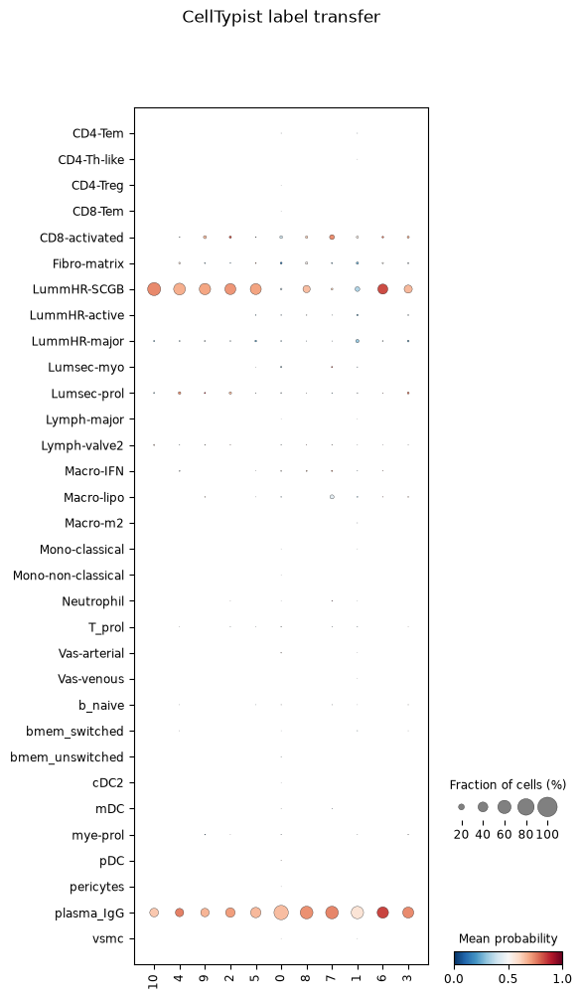

The relationship with the marker evidence is informative in both directions.


Where the two agree, the reference matches support the marker-based interpretation. Group `1`, whose markers are dominated by immunoglobulin chains, matches `plasma_IgG` for **313 of its 578 spots (54.15%)**. Groups `2`, `4` and `5` have epithelial-associated marker programmes, and `LummHR-SCGB` is their most frequent reference match, accounting for **210 of 451 spots (46.56%)**, **216 of 425 spots (50.82%)** and **167 of 359 spots (46.52%)**, respectively. You can check these values in the optional cross-tabulation above.

Where they disagree, the disagreement is the lesson. Group `0` carries fibroblast- and extracellular-matrix-associated markers alongside immunoglobulin expression. Its most frequent reference match is `plasma_IgG`, assigned to **404 of 609 spots (66.34%)**, and **29 distinct reference labels** appear across the group. Abundant immunoglobulin transcripts can influence the closest reference match for a mixed spot. The percentage describes how many spots received the label.

> <details-title>Why majority voting is disabled in this tutorial</details-title>
>
> Majority voting refines the direct predictions using the most common reference label within transcriptionally similar subclusters (). For multicellular Visium spots, this can suppress minority reference signals and make mixed expression profiles appear more uniform than they are.
>
> Those minority signals may be informative in a tumour microenvironment analysis, so majority voting is left off here and the direct `predicted_labels` are used instead. The resulting annotations preserve variation in reference similarity across spots, but still do not identify their individual constituent cells.
>
{: .details}


> <question-title>Is a CellTypist label a cell identity?</question-title>
>
> Which sentence is better supported by this experiment?
>
> A. "This spot is a plasma cell."
>
> B. "This spot has its closest reference match to the `plasma_IgG` profile."
>
> > <solution-title></solution-title>
> >
> > **B.** The measurement is a Visium spot that can contain RNA from several cells. CellTypist reports transcriptional similarity to categories in a single-cell reference. A defensible interpretation combines that result with Leiden markers, spatial position, histology and biological knowledge.
> >
> {: .solution}
>
{: .question}

# Ligand-receptor rankings with LIANA

LIANA combines ligand-receptor resources and inference methods to rank expression-compatible source-to-target pairs (, ). Here the source and target categories are the **`leiden_res_0.8` groups of Visium spots**, not purified cell populations. That distinction makes the results hypotheses about tissue regions/programmes rather than direct observations of cell-to-cell signalling.

> <hands-on-title>Rank candidate ligand-receptor pairs</hands-on-title>
>
> 1.  with the following parameters:
>    -  *"Annotated data matrix"*: `AnnData with Moran's I`
>    - *"Method for ligand-receptor inference"*: `Aggregate ligand-receptor scores from multiple methods (rank_aggregate)`
>        - *"Group By"*: `leiden_res_0.8`
>        - *"Interaction source"*: `Use built-in database`
>            - *"Resource source"*: `Download from LIANA API`
>                - *"Ligand-receptor database"*: `consensus - Combined databases (recommended)`
>        - *"Minimum expression proportion"*: `0.1`
>        - *"Aggregation method"*: `RobustRankAggregate (rra)`
>        - *"Consensus options"*: `Default (Specificity and Magnitude)`
>        - *"Return all interactions"*: `No`
>        - *"Results key in adata.uns"*: `liana_res`
>        - *"Use raw counts"*: `No`
>
> 2. **Rename**  the generated file `Final LIANA AnnData`.
>
{: .hands_on}

The retained `liana_res` table contains **141,756 rows**. Each row represents a ligand–receptor pair for a particular source and target group. The seven highest-ranked results by specificity are shown below.

| Source | Target | Ligand | Receptor | Specificity rank |
| --- | --- | --- | --- | ---: |
| `10` | `7` | *PIP* | *CD4* | 2.28 × 10⁻⁹ |
| `5` | `5` | *ALB* | *LRP2* | 6.13 × 10⁻⁹ |
| `10` | `0` | *PIP* | *CD4* | 7.47 × 10⁻⁹ |
| `0` | `6` | *IGHG1_IGLC1* | *FCGR3B* | 1.97 × 10⁻⁸ |
| `0` | `7` | *C3* | *CD19* | 4.83 × 10⁻⁸ |
| `5` | `8` | *ALB* | *LRP2* | 5.42 × 10⁻⁸ |
| `10` | `6` | *PIP* | *NPTN* | 5.58 × 10⁻⁸ |

Smaller values indicate a higher ranking. *PIP*–*CD4* from group `10` to group `7` ranks first by specificity, yet spots in those groups share spatial edges less often than expected under the permutation null (**z ≈ −2.94**). LIANA ranks candidates from group-level expression. The spatial graph adds separate evidence about whether the groups tend to be neighbours.

> <details-title>Magnitude and specificity rank different things</details-title>
>
> Sorting by `magnitude_rank` puts *HLA-A*–*ERBB2* at the top for several source–target combinations. Its two highest-ranked combinations are `8` → `6` (**4.48 × 10⁻¹⁰**) and `7` → `6` (**4.03 × 10⁻⁹**).
>
> Magnitude ranks candidates by the strength of their expression-based scores. Specificity ranks them by how selectively the scores favour particular source and target groups. Smaller values indicate a higher ranking in either column.
>
{: .details}

> <question-title>Read LIANA together with the spatial graph</question-title>
>
> *HLA-A*–*ERBB2* ranks first by magnitude for `8` → `6` and second for `7` → `6`. Which combination has more support from the spatial graph for a hypothesis that depends on the groups being neighbours?
>
> > <solution-title></solution-title>
> >
> > Groups `7` and `6` share spatial edges more often than expected (**z ≈ +6.31**), whereas groups `8` and `6` share fewer than expected (**z ≈ −10.61**). The `7` → `6` candidate therefore has more support from the neighbourhood graph. The graph measures adjacency between spot groups. Testing signalling direction, receptor activation or a functional effect would require additional evidence.
> >
> {: .solution}
>
{: .question}

> <comment-title>What would make a ligand-receptor candidate worth following up?</comment-title>
>
> Look for several independent forms of support: ligand and receptor expression in the relevant source and target groups; a good specificity as well as magnitude ranking; spatial adjacency or a biologically plausible diffusible mechanism; marker genes that independently support the interpretation of the source and target programmes; literature in breast cancer or the relevant tissue context; and replication in another section. Protein-level or perturbation evidence is needed before the language moves from "candidate" to a functional interaction.
>
{: .comment}

# Return the processed table to SpatialData

Everything computed so far lives in the AnnData table: quality-control fields, PCA and UMAP coordinates, three Leiden assignments, ranked-gene metadata, the spatial graph and its statistics, CellTypist labels and the LIANA rankings. None of it is yet attached to the tissue. Writing the table back into the SpatialData object restores that link, so each annotation can be drawn on the histology it came from and the object can be shared as a single self-describing unit.

> <hands-on-title>Create the final processed SpatialData object</hands-on-title>
>
> 1.  with the following parameters:
>    -  *"SpatialData object"*: `V1_Breast_Cancer_Block_A_Section_1.spatialdata.zip`
>    - *"Operation"*: `Import anndata table to a SpatialData object`
>        -  *"annotated data object to add"*: `Final LIANA AnnData`
>        - *"Table name"*: `table_processed`
>
> 2.  with the following parameters:
>    -  *"SpatialData object"*: `The SpatialData object from the previous`  `step`
>    - In *"Render Images"*:
>        - *"Image element name"*: `V1_Breast_Cancer_Block_A_Section_1_hires_image`
>    - In *"Render Shapes"*:
>        - *"Shapes element name"*: `V1_Breast_Cancer_Block_A_Section_1`
>        - *"Color column"*: `leiden_res_0.8`
>        - *"Scale factor"*: `1.0`
>        - *"Table name"*: `table_processed`
>    - In *"Plot Display Parameters"*:
>        - *"Coordinate system(s)"*: `V1_Breast_Cancer_Block_A_Section_1`
>        - *"Legend location"*: `Right margin`
>        - *"Enable colorbars?"*: `Yes`
>
>
{: .hands_on}

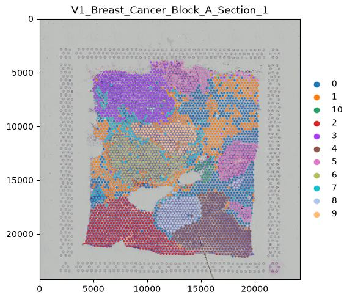

The tissue view is the final consistency check. A UMAP group that looked coherent in expression space can now be judged against histology and neighbouring groups. Group territories that are spatially coherent strengthen the interpretation that clustering has captured reproducible tissue programmes, while mixed boundaries are expected where Visium spots collect RNA from more than one cell population.

> <question-title>Interpret group 7 across the analyses</question-title>
>
> Group `7` has high-ranking markers such as *HLA-DRA*, *CD74* and *LYZ*, which support an antigen-presentation and myeloid-associated expression programme. Its most frequent CellTypist match is `plasma_IgG`, assigned to **120 of 214 spots (56.07%)**. Squidpy shows that groups `7` and `6` are neighbours more often than expected (**z ≈ +6.31**), and LIANA ranks *HLA-A*–*ERBB2* second by magnitude for `7` → `6`. The final map shows where the spots lie on the tissue.
>
> How can the marker programme and the CellTypist result both describe group `7`? What do the other results add?
>
> > <solution-title></solution-title>
> >
> > The marker ranking describes genes enriched across group `7`. CellTypist assigns each spot the closest reference match to its mixed expression profile, so the two results can capture different signals from the same spots. Squidpy describes how often groups `7` and `6` are neighbours, while the histology map shows where those spots are located. LIANA adds an expression-based candidate for follow-up. Establishing the cellular composition of the spots or testing whether the candidate mediates signalling would require additional evidence ().
> >
> {: .solution}
>
{: .question}

# Conclusion

We analysed the **Human Breast Cancer, Block A Section 1** Visium tissue section as a spatial transcriptomics experiment rather than as a single-cell dataset. The prepared expression table began with **3,798 capture spots × 36,601 genes**. Sequential spot and gene filtering retained **3,795 spots × 22,240 genes**: only 3 spots were removed, while the requirement that a gene be detected in at least three spots removed 14,361 rarely detected features.

The filtered expression matrix was normalised to **10,000 counts per spot**, log-transformed and annotated with **3,000 highly variable genes** without subsetting away the remaining genes. The main 50-component PCA was calculated on this non-regressed log-normalised branch and used to build a **15-neighbour expression graph** and UMAP. A separate `regress_out(total_counts)` branch showed that the association of early PCs with total count could be removed, but that residualised matrix was deliberately kept out of CellTypist and the main graph because it no longer represents log-normalised expression.


Leiden resolutions **0.4, 0.8 and 1.2** yielded **9, 11 and 16 groups**, respectively. Resolution 0.8 was carried forward as an intermediate partition supported by changes in group membership and marker-gene interpretation, rather than UMAP appearance alone. The adjusted Rand index was **0.654** between resolutions 0.4 and 0.8, and **0.704** between 0.8 and 1.2. At resolution 0.4, group `0` contained **1,390 spots**, of which 608, 556 and 194 were assigned to groups `0`, `1` and `7`, respectively, at resolution 0.8. Their marker rankings suggest stromal and extracellular-matrix-associated, immunoglobulin-rich, and antigen-presentation/myeloid-associated expression programmes, respectively (). This provides a biological rationale for examining the intermediate partition while recognising that the Leiden groups are expression-defined groups of multicellular Visium spots, not necessarily distinct cell types.

Squidpy used physical adjacency on the Visium grid to describe spatial organisation. Centrality described graph position, neighbourhood enrichment compared observed adjacency with shuffled group labels, and Moran's I identified spatially autocorrelated genes such as *CRISP3* (0.729) and *CPB1* (0.712). The tissue map showed where *CRISP3* expression was concentrated, consistent with its enrichment in Leiden group `4`.

CellTypist assigned each of the **3,795 spots** its closest adult-breast reference label, yielding **32 distinct labels**. The reference matches summarised expression at the spot level, while the marker rankings described expression programmes across Leiden groups. LIANA then ranked **141,756** combinations of ligand–receptor pairs and source and target groups. *PIP*–*CD4* from group `10` to group `7` ranked first by specificity, even though those groups shared fewer spatial edges than expected under permutation (**z ≈ −2.94**). Comparing the LIANA rankings with the spatial graph helps identify which candidates have both expression and neighbourhood support for follow-up ().

Finally, the processed AnnData table was returned to the original SpatialData object as `table_processed`, and `leiden_res_0.8` was drawn over the histology. The final object therefore keeps expression-derived groups, reference annotations, spatial statistics and ligand-receptor rankings attached to the tissue coordinates that give them context.

This analysis maps expression-defined groups of Visium capture spots. A spot can contain RNA from several cells, and methods such as cell2location and RCTD use suitable reference expression profiles to estimate cell-type contributions within spots (, ). The [companion Xenium melanoma tutorial](https://gxy.io/GTN:T00592) works at the level of segmented cells, where transcript assignment depends on the inferred cell boundaries.
